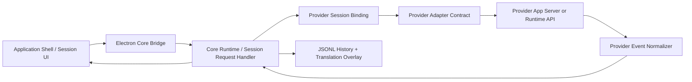

# CodeAI Hub Provider Runtime Alignment

## Decision

Harness AI must follow the CodeAI Hub provider/runtime reference flow. The former direct `provider-turn-runner` path and the simplified provider wrappers were not valid foundations for MVP provider execution (the orphaned `provider-turn-runner` module was removed by the 2026-07-05 legacy cleanup) because they bypassed the Core-owned and provider-owned layers that Harness AI needs for:

- session JSONL history and translation overlays;
- realtime thinking/reasoning translation;
- normalized provider event routing;
- model/reasoning binding from settings;
- provider home/auth materialization;
- stale binding recovery and stop/resume lifecycle;
- provider-native system prompt, tools, runtime profile, and process/session control;
- future intent normalization and orchestration envelopes.

The direct runner and wrapper-only provider adapters can remain only as historical implementation debt until replaced. New provider work must not extend them.

## Reference Flow

CodeAI Hub routes a session turn through these boundaries:

1. UI sends raw session action to the Core bridge.
2. Core `SessionRequestHandler` resolves or creates a Core session.
3. Core binds the session to a provider adapter using `createSession` or `resumeSession`.
4. Core persists visible user messages before dispatch.
5. Core attaches applied provider turn config from settings/session model binding.
6. Core dispatches to the provider adapter through the shared adapter contract.
7. Provider adapter owns the provider process or API integration.
8. Provider-specific events are normalized into provider-neutral session events.
9. Core persists assistant/thinking/system messages and translation overlays.
10. UI renders Core snapshots and stream events only.

## Harness AI Target Flow

Harness AI should use the same authority split:

Renderer and Electron host must not call provider CLIs or SDKs directly. They may only send UI intents to Core and render Core-owned snapshots/events.

Visible reasoning translation follows this same authority split. Provider
Runtime exposes provider-backed translation engines, but Core resolves the
reasoning language/engine policy from settings, marks eligible visible
reasoning messages as pending, stores translated overlays as sidecar records,
and broadcasts `session:message_translation` patches. The renderer applies
`localizedContent` for display and must keep source `text` as Core truth.

## Module Direction

The product tree replaced the role of `provider-turn-runner` with explicit modules (complete — the orphaned runner module itself was deleted by the 2026-07-05 legacy cleanup):

- Core Runtime / Session Runtime:
  - `session-request-handler`
  - `provider-session-binding`
  - `session-event-stream`
  - `session-reasoning-display`
- Provider Runtime / Provider Adapters:
  - `provider-adapter-contract`
  - one adapter module per provider
- Provider Runtime / Provider Events And Translation:
  - `provider-event-normalizer`
  - `provider-translation-engines`
- Core Runtime / Settings And Localization:
  - `localization-runtime`
  - `reasoning-translation-overlay`
- Application Shell / Electron Host:
  - `core-process-bridge`

## Immediate Implementation Rule

From this scope forward, provider execution must enter through Core session dispatch. Any shortcut that calls a provider outside the CodeAI Hub-style Core/provider adapter path requires explicit user approval before implementation.

Visible provider reasoning follows the same rule: provider adapters request provider-native visible reasoning where the provider requires an explicit turn option, provider events enter Core, `session-reasoning-display` projects explicit thinking events or tagged visible reasoning into Core `thinking` messages, and the UI only renders the projected session messages. Provider-native persistence under isolated provider homes is separate from Harness Core dialog JSONL history under `<workspace>/.harness/sessions/**`.

Translation overlays are Core-owned display state. Session JSONL remains the
canonical source transcript, while translated reasoning sidecars live under the
workspace session sidecar directory and are reapplied only when the stored
source hash still matches the message text. UI localization bundles are a
separate materialized runtime payload and do not depend on reasoning overlay
settings.

Live assistant text follows the CodeAI Hub append-only contract: providers may emit assistant chunks tagged `live`; Core preserves that tag, coalesces consecutive live chunks for session readback/display, and suppresses or reduces a later full-text final answer when the live text already covers it. Renderer code must not infer provider chunk semantics without this Core/shared contract.

## Reference Module Migration Map

This migration is provider-by-provider. CodeAI Hub is the behavioral source of truth; Harness adaptation is limited to product-tree placement, facade boundaries, imports, focused tests, and Core contract integration.

### Claude

Reference source:

- `CodeAI-Hub/packages/Claude_Module/src/auth/**`
- `CodeAI-Hub/packages/Claude_Module/src/installer/**`
- `CodeAI-Hub/packages/Claude_Module/src/sdk/**`
- `CodeAI-Hub/packages/Claude_Module/src/session/**`
- `CodeAI-Hub/packages/Claude_Module/src/messaging/**`
- `CodeAI-Hub/packages/Claude_Module/src/provider/**`
- `CodeAI-Hub/packages/Claude_Module/src/types/**`

Harness target:

- `product-parts/provider-runtime/clusters/provider-adapters/modules/claude-provider/**`

Required behavior:

- Replace `claude --print` wrapper behavior with the Claude Agent SDK manager/session path.
- Preserve SDK query options for `cwd`, `projectPath`, `additionalDirectories`, `settingSources`, `systemPrompt`, `tools`, `model`, `effort`, `thinking`, `resume`, and structured output.
- Preserve thinking stream handling: content block start/delta/stop, thinking live buffer, text live buffer, final thinking reconciliation, and `dialog_message` emissions tagged as `thinking`.
- Preserve auth/home bridge, usage/context probes, stale binding handling, and runtime profile behavior. (The migrated `/context` probe was later retired on 2026-07-14: token usage now streams from the Agent SDK usage tracker per API call.)
- In the packaged macOS app, preserve reference installer behavior while augmenting the npm runner PATH for GUI launches so Homebrew npm can be found before Claude SDK setup.

### Codex

Reference source:

- `CodeAI-Hub/packages/Codex_AppServer_Module/src/app-server/**`
- `CodeAI-Hub/packages/Codex_AppServer_Module/src/app-server/process/**`
- `CodeAI-Hub/packages/Codex_AppServer_Module/src/provider/**`
- `CodeAI-Hub/packages/Codex_AppServer_Module/src/diagnostics/**`
- `CodeAI-Hub/packages/Codex_AppServer_Module/src/translation/**`
- `CodeAI-Hub/packages/Codex_AppServer_Module/src/types/**`

Harness target:

- `product-parts/provider-runtime/clusters/provider-adapters/modules/codex-provider/**`
- `product-parts/provider-runtime/clusters/provider-home-and-auth/modules/provider-home-manager/**`

Required behavior:

- Replace partial app-server logic with the reference process/facade/event-router stack.
- Preserve app-server process profile, provider home/auth normalization, base instructions/config, thread start/resume, stale binding handling, turn interrupt, and usage limit updates.
- Preserve reasoning behavior: summary params, summary stream buffer, live reasoning fallback buffer, item completion reconciliation, agent message delta buffering, and `thinking` tagged dialog messages.
- Preserve stable reasoning summary block identities:
  `<itemId>::summary-block::<index>`, stream completed summary paragraphs when
  the next part starts, and do not duplicate already-streamed blocks when the
  final item arrives.
- Preserve Codex capability and Spark summary gating from the reference module.

### Kimi (removed)

Reference source:

- `CodeAI-Hub/packages/Kimi_Module/src/wire/**`
- `CodeAI-Hub/packages/Kimi_Module/src/session/**`
- `CodeAI-Hub/packages/Kimi_Module/src/provider/**`
- `CodeAI-Hub/packages/Kimi_Module/src/messaging/**`
- `CodeAI-Hub/packages/Kimi_Module/src/types/**`

Former Harness target:

- `product-parts/provider-runtime/clusters/provider-adapters/modules/kimi-provider/**`

Status:

- Removed by the kimi-provider retirement (2026-07-05 user order). The visible
  Kimi runs through `kimi-client-provider` on the Core universal client
  (subscription-key `api.kimi.com/coding/v1` endpoint, `kimi-for-coding`
  model); the ACP `kimi acp` subprocess adapter and its Kimi native-capture
  channel were removed end-to-end, and the ported reference sources stay in
  git history. The accepted 2026-07-03 Kimi capture dumps remain the
  synthetic-native material for Phase R.

### GLM Native (removed)

Reference source:

- `CodeAI-Hub/packages/GLM_Module/src/provider/**`

Former Harness target:

- `product-parts/provider-runtime/clusters/provider-adapters/modules/glm-native-provider/**`

Status:

- Removed by the legacy provider cleanup (2026-07-05). The visible GLM runs
  through `glm-client-provider` on the Core universal client; the ported
  reference runtime (agent loop, tools, SSE parser) was consolidated into the
  `universal-client` Core cluster before the module deletion, and the sources
  stay available in git history.

### GLM OpenCode (removed)

Reference source:

- `CodeAI-Hub/packages/GLM_OpenCode_Module/src/provider/**`

Former Harness target:

- `product-parts/provider-runtime/clusters/provider-adapters/modules/glm-opencode-provider/**`

Status:

- Removed in the Universal Client GLM migration (2026-07-04). The visible GLM
  provider now runs through `glm-client-provider` on the Core universal client,
  and the embedded OpenCode runtime/module/dependency are no longer production
  targets.
- OpenCode remains a historical/reference project for behavior and extensibility
  research; its embedded runtime is not retained in Harness production code.

### OpenRouter And Local Models (removed)

Reference source:

- OpenRouter settings/search/endpoint behavior in CodeAI Hub settings and workflow services.
- `CodeAI-Hub/packages/core/src/local-models/**`

Former Harness targets:

- `product-parts/provider-runtime/clusters/provider-adapters/modules/openrouter-provider/**`
- `product-parts/provider-runtime/clusters/provider-adapters/modules/local-models-provider/**`

Status:

- Removed by the legacy provider cleanup (2026-07-05). The visible OpenRouter
  and Local Models run through `openrouter-client-provider` /
  `local-models-client-provider` on the Core universal client (Phase 4
  migration, user-accepted 2026-07-05); the behavior contracts listed here
  (endpoint/model selection, request-body wire form, reasoning stream
  coalescing, context-length handling) live on in the universal client and
  its endpoint modules, and the ported reference sources stay in git history.
