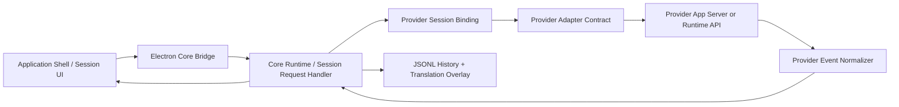

# CodeAI Hub Provider Runtime Alignment

## Decision

Harness AI must follow the CodeAI Hub provider/runtime reference flow. The current direct `provider-turn-runner` path is not a valid foundation for MVP provider execution because it bypasses the Core-owned layers that Harness AI needs for:

- session JSONL history and translation overlays;
- realtime thinking/reasoning translation;
- normalized provider event routing;
- model/reasoning binding from settings;
- provider home/auth materialization;
- stale binding recovery and stop/resume lifecycle;
- future intent normalization and orchestration envelopes.

The direct runner can remain only as historical implementation debt until replaced. New provider work must not extend it.

## Reference Flow

CodeAI Hub routes a session turn through these boundaries:

1. UI sends raw session action to the Core bridge.
2. Core `SessionRequestHandler` resolves or creates a Core session.
3. Core binds the session to a provider adapter using `createSession` or `resumeSession`.
4. Core persists visible user messages before dispatch.
5. Core attaches applied provider turn config from settings/session model binding.
6. Core dispatches to the provider adapter through the shared adapter contract.
7. Provider adapter owns the provider process or API integration.
8. Provider-specific events are normalized into provider-neutral session events.
9. Core persists assistant/thinking/system messages and translation overlays.
10. UI renders Core snapshots and stream events only.

## Harness AI Target Flow

Harness AI should use the same authority split:

Renderer and Electron host must not call provider CLIs or SDKs directly. They may only send UI intents to Core and render Core-owned snapshots/events.

## Module Direction

The next product-tree update should replace the role of `provider-turn-runner` with explicit modules:

- Core Runtime / Session Runtime:
  - `session-request-handler`
  - `provider-session-binding`
  - `session-event-stream`
  - `session-reasoning-display`
- Provider Runtime / Provider Adapters:
  - `provider-adapter-contract`
  - one adapter module per provider
- Provider Runtime / Provider Events And Translation:
  - `provider-event-normalizer`
  - `provider-translation-engines`
- Application Shell / Electron Host:
  - `core-process-bridge`

## Immediate Implementation Rule

From this scope forward, provider execution must enter through Core session dispatch. Any shortcut that calls a provider outside the CodeAI Hub-style Core/provider adapter path requires explicit user approval before implementation.

Visible provider reasoning follows the same rule: provider events enter Core, `session-reasoning-display` projects explicit thinking events or tagged visible reasoning into Core `thinking` messages, and the UI only renders the projected session messages.
