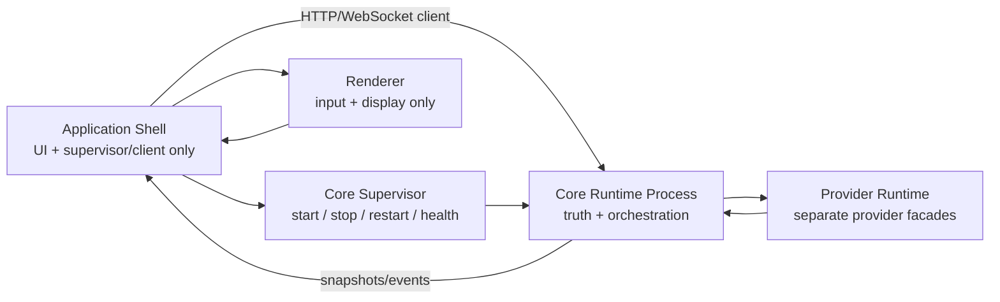

# Reference Core Runtime Boundary

## Decision

Harness AI must restore the CodeAI-Hub runtime boundary:

- Core Runtime runs out-of-process as the local authority.
- Application Shell is only an interface plus Core supervisor/client.
- Provider Runtime modules stay separate and are composed by Core, not by the
  Application Shell.

The current Electron-host composition is architecture debt. It may exist only
until this scope replaces it.

## CodeAI-Hub Reference

Reference files:

- `/Users/oleksandroliinyk/VSCODE/CodeAI-Hub/src/extension-module/core/core-process-manager.ts`
- `/Users/oleksandroliinyk/VSCODE/CodeAI-Hub/packages/core-supervisor/src/index.ts`
- `/Users/oleksandroliinyk/VSCODE/CodeAI-Hub/src/client/ui/src/core-bridge/core-bridge.ts`
- `/Users/oleksandroliinyk/VSCODE/CodeAI-Hub/src/client/ui/src/core-bridge/supervisor-requests.ts`

Reference behavior:

1. The shell/extension ensures Core is installed and started.
2. The Core supervisor starts Core as a detached child process.
3. Startup waits for `/api/v1/health`.
4. Shutdown goes through `POST /api/v1/shutdown`.
5. A process lock prevents duplicate Core managers from starting competing Core instances.
6. A runtime registry records the selected Core port.
7. UI connects to Core through HTTP/WebSocket and sends user intents only.

## Harness Target Boundary

## Application Shell Contract

Application Shell may:

- create and manage Electron windows;
- expose renderer-safe UI APIs;
- start, stop, restart and health-check the Core process through the supervisor;
- connect to Core through HTTP/WebSocket contracts;
- forward user input to Core;
- render Core snapshots/events.

Application Shell must not:

- import Core Runtime implementation modules;
- import provider adapter implementation modules;
- instantiate provider facades;
- register provider adapters;
- own session state, provider state, settings truth, usage-limit truth, workflow decisions, managed lifecycle or localization truth;
- parse provider streams or infer provider semantics;
- write session history except through Core-owned contracts.

## Core Runtime Contract

Core Runtime owns:

- workspace registry and active workspace truth;
- session create/resume/send/stop lifecycle;
- provider adapter registration and provider session binding;
- settings snapshots and next-session mode truth;
- JSONL session history;
- provider event normalization and reasoning projection;
- usage/context telemetry;
- workflow and managed lifecycle decisions.

Core exposes only stable process contracts to Application Shell:

- health/status endpoint;
- shutdown endpoint;
- HTTP request endpoints for user intents and read models;
- WebSocket stream for Core-owned events.

## Provider Runtime Contract

Provider Runtime modules stay independent:

- one provider module per provider;
- each provider module exposes its own facade;
- provider-specific process/API/session logic stays provider-owned;
- provider homes/auth/runtime files stay provider-owned;
- provider events flow back to Core through shared contracts.

Provider Runtime must not be composed by Application Shell. Core Runtime is the
only owner allowed to instantiate and register provider adapters.

## Required Cleanup

This scope must remove or replace:

- Application Shell direct imports of `core-runtime/**`;
- Application Shell direct imports of provider adapter facades;
- Application Shell provider adapter construction and registry writes;
- renderer imports of provider-runtime implementation types when a Core read-model contract should be used instead;
- misleading `Restart Core` behavior that only rebuilds provider adapters in-process.

## Regression Preservation Contract

Moving Core out of the Electron process changes the transport boundary only. It
must not change the user-visible session/provider contracts that already work.

The Application Shell must continue to receive these Core-owned read models and
events after the refactor:

- session lifecycle events: created, restored, deleted and active turn state;
- user, assistant, system, thinking and live assistant messages;
- provider binding state with Core session id and provider session id;
- runtime model/provider status;
- token usage and context-window telemetry;
- provider usage limits, including 5-hour/session and weekly buckets where the provider exposes them;
- visible reasoning/thinking projection;
- append-only session JSONL readback under `<workspace>/.harness/sessions/**`;
- settings-driven model, reasoning and provider auth selections;
- refreshed read models after real Core restart/reconnect.

The refactor is not accepted if Application Shell needs local heuristics to
rebuild any of those facts. They must be emitted by Core or provider modules
through Core contracts.

## Verification Guards

Each implementation phase that changes the Core process boundary must preserve
or add the smallest runnable checks for the contracts it touches. At minimum
the final package verification must cover:

- Core health endpoint reports ready before UI session calls proceed;
- Core shutdown endpoint stops the process and restart starts a fresh process;
- restored sessions still hydrate their JSONL events;
- provider binding survives Core-owned resume/rebind paths;
- token/context telemetry still reaches the session read model;
- usage-limit telemetry still reaches the session read model;
- reasoning/thinking events still project into dialog messages;
- settings changes are persisted by Core and visible after reconnect;
- Application Shell contains no direct provider facade construction or provider adapter registration.

## Acceptance Criteria

- Starting Harness AI starts or attaches to a separate Core process.
- Quitting Core through the UI calls the Core shutdown contract.
- Restart Core performs a real stop/start sequence.
- Application Shell can be killed without being the source of workflow truth.
- Provider modules are instantiated by Core process code only.
- Architecture checks fail on direct Application Shell imports of Core Runtime implementation modules or provider adapter implementation modules.
- Existing UI-visible telemetry, provider limits, reasoning, session history and settings contracts still work through Core process contracts.
