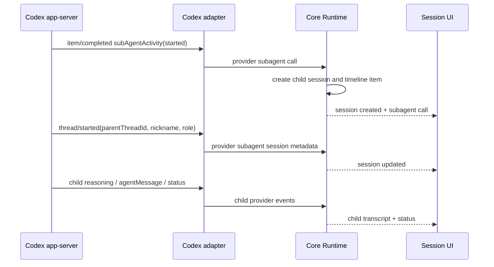

# Сессии субагентов

## Цель

Harness AI показывает работу субагентов Codex app-server как полноценное
дерево Core-сессий, а не как текстовую эвристику в renderer. Пользователь
видит точку запуска субагента в диалоге основной сессии, может открыть его
живой read-only диалог в центральной области или открепить его в отдельное
окно.

Согласованный прототип: [Harness AI — Subagent Sessions UX Prototype](https://www.figma.com/design/kCyw0MBXSjdCoV1wh43vui).

## Источник правды

Codex app-server уже предоставляет структурированные данные:

- `item/completed` с актуальным `subAgentActivity` — id вызова, child thread id,
  agent path и вид действия `started/interacted/interrupted`; legacy-форма
  `collabAgentToolCall` также остаётся поддержанной;
- `thread/started` — `parentThreadId`, `agentNickname`, `agentRole`, `name`,
  preview, provider thread id и структурированный
  `source.subAgent.thread_spawn` дочерней сессии;
- `thread/status/changed` — живой статус дочернего thread;
- `turn/started`, `turn/completed` и terminal `error` — фактический lifecycle
  работы дочернего thread;
- обычные `agentMessage` и `reasoning` события дочернего thread — его диалог.
- `thread/list(ancestorThreadId)` и `thread/read(includeTurns=true)` —
  официальный структурированный источник descendants и завершённых items при
  восстановлении после перезапуска.

Codex adapter нормализует эти данные в provider-neutral события. Core владеет
связями parent/child, статусами, persisted read model и timeline-вставками.
Renderer только отображает Core-снимки и отправляет Core-команды. Разбор
rollout-текста или поиск слов о субагентах в UI запрещены.

У forked child поле `thread.preview` может содержать исходный текст parent.
Поэтому delegated-task label берётся из структурированного `agentPath` и лишь
при его отсутствии использует preview; explicit provider `name` по-прежнему
может задавать title.

Нормализованный provider boundary состоит из трёх событий:
`subagent_control`, `subagent_session` и `subagent_status`. Codex-native
`pendingInit/running/errored/...` переводятся в общий статусный словарь до
передачи в Core.

## Core read model

`CoreSession` получает добавочные поля:

- `sessionKind: "primary" | "subagent"`;
- `parentSessionId` для дочерней сессии;
- `agentNickname`, `agentRole`, `delegatedTask`, `reasoningEffort`;
- `subagentStatus` с provider-neutral состоянием;
- `titleOrigin: "default" | "auto" | "manual"`.

Поля добавлены как backward-compatible optional metadata: persisted sessions,
созданные до этого контракта, читаются как primary/default. Все новые records
материализуются Core lifecycle с явными значениями.

Timeline основной сессии получает `CoreSubagentCall`. Он хранит стабильный id
вызова, исходный timestamp, delegated prompt и ссылки на созданные Core child
session ids. Повторные provider-обновления меняют существующий вызов, но не
переносят его из исходной точки диалога.

Append-only история может содержать несколько snapshots одного call. При
hydration `session-event-stream` объединяет их по id в исходной позиции и
возвращает последнее состояние вызова.

Дочерняя сессия создаётся в Core сразу после структурированного spawn-события,
подписывается на уже работающий provider thread и сохраняется в workspace
session index. После перезапуска она восстанавливается и resume-ится тем же
путём, что и обычная Codex-сессия.

Если provider descendants уже существуют, но старый Core ещё не успел создать
для них records, Codex adapter запрашивает рекурсивный список через
`ancestorThreadId`, читает turns каждого thread и повторно пропускает только
структурированные collaboration items и собственные child
reasoning/agentMessage через штатный event router. Для этого adapter читает
цепочку ancestors и исключает из child transcript все turns, чьи стабильные
turn ids принадлежат ancestor threads; fork-копия parent reasoning/messages не
появляется в child view. Внутри одного процесса каждый transcript/activity replay
выполняется один раз; raw rollout JSONL не читается. При следующем запуске Core
сопоставляет повторно полученные provider messages по стабильным id +
role/tag/source text и не добавляет точные дубликаты в persisted transcript.
Изменённый текст и завершение live-tail при этом остаются обычными обновлениями.
Для этого startup сначала загружает append-only Core event files и только потом
восстанавливает `messagesBySession` и provider bindings; dedupe видит уже
сохранённые stable ids до начала app-server history replay.
После применения historical child metadata Core повторно вычисляет status
родительского timeline-call из актуального child status, поэтому восстановленный
`completed` одинаково виден в дереве и child header (timeline-панель статусов
не отображает, но read-model остаётся согласованной).
Статус `thread.status=notLoaded` означает лишь отсутствие thread в памяти нового
app-server процесса и сначала нормализуется как `pending`. После transcript
replay adapter отдельно проводит через event router последний собственный turn
child; его `completed`, `interrupted`, `failed` или `inProgress` становится
источником terminal/running truth для Core.

Forked child `thread/read` включает часть items родительской истории. Adapter
не переигрывает их как вызовы самого child: актуальный `subAgentActivity`
принадлежит thread только когда его `agentPath` является прямым потомком
структурированного path текущего агента; legacy `collabAgentToolCall`
проверяется по `senderThreadId`. Поэтому self/sibling activities не создают
ложные grandchildren и не возвращают завершённые sessions в `running`.

Live adoption не вызывает второй `thread/start`/`thread/resume`: Core берёт
adapter уже связанной parent session, подписывается на child provider thread id
и публикует ready binding. При обычном restart persisted child, напротив,
проходит штатный `resumeSession` независимо от parent order.

Завершение `subAgentActivity`/`collabAgentToolCall` означает завершение самого
вызова `spawnAgent`, а не работы созданного агента. Поэтому статус
timeline-call (Core read-model) выводится из child turn/thread status: успешный spawn работающего child остаётся
`running` до его собственного завершения. Если spawn-событие не повторяет model
и reasoning effort, Core наследует их из parent session. Для legacy parent без
сохранённого effort Core использует тот же model-aware reasoning setting,
который формирует provider turn options; поэтому восстановленный Ultra child
не теряет `Ultra` в UI metadata.

Одинаковый lifecycle применяется рекурсивно: collaboration event в child
session создаёт grandchild с `parentSessionId` этого child, не выравнивая дерево
до одного уровня.

## UX-контракт

### Диалог основной сессии

- В момент `spawnAgent` в исходной позиции timeline появляется
  разделительная линия субагентов. С 2026-07-13 (решение пользователя, см.
  `docs/architecture/ClaudeSubagentSessions.md`, раздел 5) это горизонтальная
  черта с разрывом по центру: локализованная надпись «Subagents launched» и
  суммарный счётчик запущенных субагентов. Подряд идущие запуски сливаются в
  один разделитель, и счётчик растёт на месте: 1, 2, 3, ...
- Если provider сначала прислал call без receiver id, разделитель всё равно
  появляется в исходной позиции, учитывает вызов как один запуск и
  уточняется следующим Core snapshot с тем же call id.
- Задач, кнопок открытия/открепления и живых статусов на разделителе нет:
  управление дочерними сессиями и статусы живут только в sidebar-дереве.

### Левый sidebar

- На верхнем уровне показываются только primary sessions.
- Под названием появляется строка `N субагентов · M работают`.
- Слева от имени child строки стоит статусный индикатор формы: пока работа
  идёт (`pending`/`running`) — нейтральное незалитое кольцо; итоговые статусы
  залиты цветом — зелёный `completed`, оранжевый `interrupted`, красный
  `failed`/`not_found`, серый `shutdown`. Header дочерней сессии остаётся
  залитым и использует те же итоговые цвета; timeline-панель статусов
  не показывает.
- Chevron раскрывает рекурсивное дерево потомков; grandchildren остаются на
  своём уровне вложенности.
- Выбор child автоматически раскрывает цепочку его ancestors, но остальные
  ветки сохраняют пользовательское состояние collapse/expand.
- Нажатие по строке открывает сессию в основном окне, `ExternalLink` — в
  отдельном.
- Ширина sidebar изменяется пользователем в диапазоне 240–360 px.

### Дочерняя сессия

- Диалог живой, но поле ввода отсутствует: MVP является read-only просмотром.
- Верхняя область показывает breadcrumb к parent session, delegated task,
  nickname/role, model, reasoning и status.
- `session:created` и `session:updated` обновляют индекс сессий без смены
  текущей вкладки; открытие child выполняется существующей Core-session
  навигацией и hydrates его append-only event history.
- Завершение субагента не закрывает уже откреплённое окно.

### Названия сессий

- После первого содержательного сообщения Core один раз строит короткое auto
  title из задачи (нормализация пробелов, максимум 72 символа).
- Ручное переименование устанавливает `titleOrigin=manual` и блокирует
  последующие автоматические изменения; Core принимает непустое имя длиной до
  100 символов.
- Контекстное меню позволяет снова сгенерировать auto title из первого
  пользовательского сообщения.
- Rename выполняется React-диалогом внутри приложения; native
  `window.prompt`/`window.confirm` не используются.
- Renderer отправляет только `rename-session` или
  `regenerate-session-title`; preload/Core bridge не нормализуют имя и не
  дублируют Core title state.

## Последовательность live-событий

## Откреплённые окна

Electron host хранит одно окно на `(workspaceId, sessionId)`. Повторный клик
фокусирует существующее окно. Закрытие окна удаляет запись из host registry;
завершение provider turn окно не закрывает.

Registry хранит promise уже начатого создания окна, поэтому два быстрых клика
до завершения `BrowserWindow.load*` также не создают дубликаты.

## Границы первой реализации

- Первая реализация покрыла Codex app-server, потому что только его adapter
  получает native collaboration events. С 2026-07-13 контракт расширяется на
  Claude через файловый наблюдатель в claude-provider — см.
  `docs/architecture/ClaudeSubagentSessions.md`; Core/UI контракты этого
  документа при этом не меняются.
- Providers без subagent-эмиссии продолжают работать без subagent-полей;
  UI не показывает пустые controls.
- Запуск новых субагентов вручную из UI и отправка сообщений в дочернюю сессию
  не входят в MVP.
- Исторические Codex descendants реконструируются только из app-server
  `thread/list`/`thread/read`; fallback на разбор rollout-текста для Codex
  отсутствует. Для Claude файловый JSONL — единственный native-источник,
  поэтому его чтение является штатным каналом claude-provider (не fallback).

## Критерии приёмки

1. Native-profile Codex session при `spawnAgent` показывает разделитель
   запуска в точном месте timeline и child в sidebar без перезапуска UI.
2. Child transcript получает live reasoning и ответы своего provider thread.
3. Статусы running/completed/error одинаковы в дереве и child header.
4. Open и detach работают из sidebar (разделитель в диалоге — информационный,
   без controls); повторный detach фокусирует одно окно.
5. Auto title, manual rename и regenerate сохраняются после перезапуска.
6. Parent delete не оставляет видимых orphan descendants, а каскад
   дополнительно удаляет event JSONL и reasoning-translation sidecar
   каждой сессии дерева (`.harness/sessions/events/`,
   `.harness/sessions/reasoning-translations/`).
7. Renderer не анализирует текст сообщений для определения субагентов.
8. Уже существующие provider descendants появляются в дереве вместе со своим
   завершённым transcript после восстановления Core. Конкурентные hydrations
   (parent + child) идут через одну последовательную цепочку в provider
   loader, повторный анонс уже терминально восстановленного child запрещён,
   а Core не понижает терминальный статус child историческим
   running/pending без строго более свежего события.
9. Локальный build, focused tests и visual Design QA проходят; package build
   выполняется только после отдельного подтверждения пользователя.
