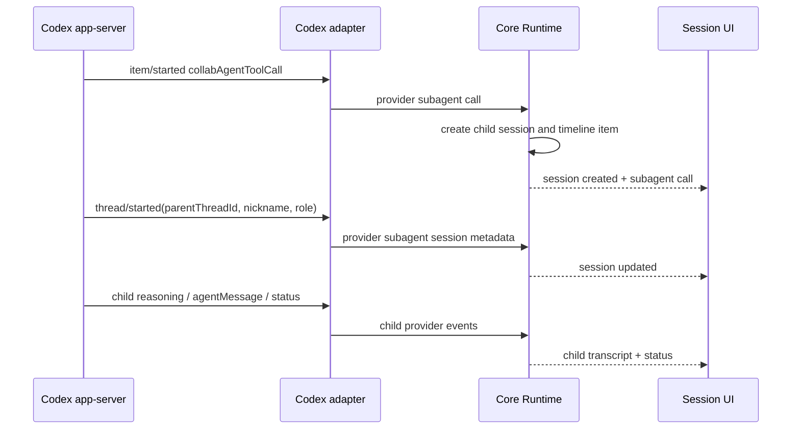

# Сессии субагентов

## Цель

Harness AI показывает работу субагентов Codex app-server как полноценное
дерево Core-сессий, а не как текстовую эвристику в renderer. Пользователь
видит точку запуска субагента в диалоге основной сессии, может открыть его
живой read-only диалог в центральной области или открепить его в отдельное
окно.

Согласованный прототип: [Harness AI — Subagent Sessions UX Prototype](https://www.figma.com/design/kCyw0MBXSjdCoV1wh43vui).

## Источник правды

Codex app-server уже предоставляет структурированные данные:

- `item/started` и `item/completed` с `collabAgentToolCall` — место вызова,
  prompt, model, reasoning effort, receiver thread ids и состояния агентов;
- `thread/started` — `parentThreadId`, `agentNickname`, `agentRole`, `name`,
  preview и provider thread id дочерней сессии;
- `thread/status/changed` — живой статус дочернего thread;
- обычные `agentMessage` и `reasoning` события дочернего thread — его диалог.

Codex adapter нормализует эти данные в provider-neutral события. Core владеет
связями parent/child, статусами, persisted read model и timeline-вставками.
Renderer только отображает Core-снимки и отправляет Core-команды. Разбор
rollout-текста или поиск слов о субагентах в UI запрещены.

Нормализованный provider boundary состоит из трёх событий:
`subagent_control`, `subagent_session` и `subagent_status`. Codex-native
`pendingInit/running/errored/...` переводятся в общий статусный словарь до
передачи в Core.

## Core read model

`CoreSession` получает добавочные поля:

- `sessionKind: "primary" | "subagent"`;
- `parentSessionId` для дочерней сессии;
- `agentNickname`, `agentRole`, `delegatedTask`, `reasoningEffort`;
- `subagentStatus` с provider-neutral состоянием;
- `titleOrigin: "default" | "auto" | "manual"`.

Поля добавлены как backward-compatible optional metadata: persisted sessions,
созданные до этого контракта, читаются как primary/default. Все новые records
материализуются Core lifecycle с явными значениями.

Timeline основной сессии получает `CoreSubagentCall`. Он хранит стабильный id
вызова, исходный timestamp, delegated prompt и ссылки на созданные Core child
session ids. Повторные provider-обновления меняют существующую карточку, но не
переносят её из исходной точки диалога.

Append-only история может содержать несколько snapshots одного call. При
hydration `session-event-stream` объединяет их по id в исходной позиции и
возвращает последнее состояние карточки.

Дочерняя сессия создаётся в Core сразу после структурированного spawn-события,
подписывается на уже работающий provider thread и сохраняется в workspace
session index. После перезапуска она восстанавливается и resume-ится тем же
путём, что и обычная Codex-сессия.

Live adoption не вызывает второй `thread/start`/`thread/resume`: Core берёт
adapter уже связанной parent session, подписывается на child provider thread id
и публикует ready binding. При обычном restart persisted child, напротив,
проходит штатный `resumeSession` независимо от parent order.

`collabAgentToolCall.status=completed` означает завершение самого вызова
`spawnAgent`, а не работы созданного агента. Поэтому статус карточки выводится
из `agentsStates`/child thread status: успешный spawn работающего child остаётся
`running` до его собственного завершения.

Одинаковый lifecycle применяется рекурсивно: collaboration event в child
session создаёт grandchild с `parentSessionId` этого child, не выравнивая дерево
до одного уровня.

## UX-контракт

### Диалог основной сессии

- В момент `spawnAgent` появляется компактная карточка субагента.
- Карточка показывает задачу, nickname/role, model + reasoning и живой статус.
- Нажатие по карточке открывает дочернюю сессию в центральной области.
- `ExternalLink` открывает или фокусирует отдельное окно этой сессии.

### Левый sidebar

- На верхнем уровне показываются только primary sessions.
- Под названием появляется строка `N субагентов · M работают`.
- Chevron раскрывает рекурсивное дерево потомков; grandchildren остаются на
  своём уровне вложенности.
- Нажатие по строке открывает сессию в основном окне, `ExternalLink` — в
  отдельном.
- Ширина sidebar изменяется пользователем в диапазоне 240–360 px.

### Дочерняя сессия

- Диалог живой, но поле ввода отсутствует: MVP является read-only просмотром.
- Верхняя область показывает breadcrumb к parent session, delegated task,
  nickname/role, model, reasoning и status.
- Завершение субагента не закрывает уже откреплённое окно.

### Названия сессий

- После первого содержательного сообщения Core один раз строит короткое auto
  title из задачи.
- Ручное переименование устанавливает `titleOrigin=manual` и блокирует
  последующие автоматические изменения.
- Контекстное меню позволяет снова сгенерировать auto title из первого
  пользовательского сообщения.
- Rename выполняется React-диалогом внутри приложения; native
  `window.prompt`/`window.confirm` не используются.

## Последовательность live-событий

## Откреплённые окна

Electron host хранит одно окно на `(workspaceId, sessionId)`. Повторный клик
фокусирует существующее окно. Закрытие окна удаляет запись из host registry;
завершение provider turn окно не закрывает.

## Границы первой реализации

- Реализуется Codex app-server, потому что только его текущий adapter получает
  native collaboration events.
- Другие providers продолжают работать без subagent-полей; UI не показывает
  пустые controls.
- Запуск новых субагентов вручную из UI и отправка сообщений в дочернюю сессию
  не входят в MVP.
- Исторические Codex descendants, созданные до появления Core child record, не
  реконструируются из rollout-текста. Новые child records сохраняются и
  восстанавливаются штатно.

## Критерии приёмки

1. Native-profile Codex session при `spawnAgent` показывает карточку в точном
   месте timeline и child в sidebar без перезапуска UI.
2. Child transcript получает live reasoning и ответы своего provider thread.
3. Статусы running/completed/error одинаковы в карточке, дереве и child header.
4. Open и detach работают из карточки и sidebar; повторный detach фокусирует
   одно окно.
5. Auto title, manual rename и regenerate сохраняются после перезапуска.
6. Parent delete не оставляет видимых orphan descendants.
7. Renderer не анализирует текст сообщений для определения субагентов.
8. Локальный build, focused tests и visual Design QA проходят; package build
   выполняется только после отдельного подтверждения пользователя.
