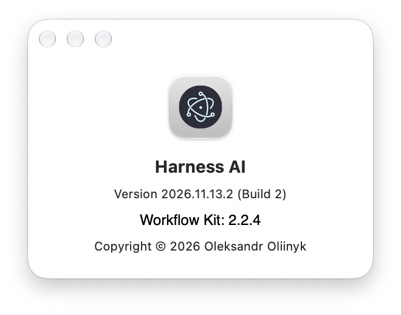

# Application versions and native About evidence

Date: 2026-11-13. Scope: `application-versions-about-2026-11-13`.
Specification: [ApplicationVersionsAndAbout-2026-11-13.md](../architecture/ApplicationVersionsAndAbout-2026-11-13.md).
Execution: sequential, no reviewer, as requested by the user.

## Source changes

- T001 `7f9509ac`: explicit release tag, immutable build descriptor and automatic
  package/macOS version parameters. Source package.json.version remains 0.0.0.
- T002 `228fa99f`: Core get-product-info validates the descriptor and snapshots
  the full application version plus the Kit compiled into the application.
- T003 `f56e49af`: native About reads those facts through Core process bridge.
- DOCS `2c13ff2c`: release instructions and architecture reconciled.

All source tasks passed the configured commit profile. Final `npm run quality`
passed, including `Tests: OK (231)`. Duplication and link checks passed;
`npm audit --omit=dev --audit-level=high` reported zero vulnerabilities.
No new dependencies or Workflow Kit source changes were required.

## Package metadata

The tag was chosen before packaging: **v2026.11.13.2**.
The command `HARNESS_RELEASE_TAG=v2026.11.13.2 npm run package:mac`
completed successfully, including the build and standalone Kit smoke tests.

- Full application release version: **2026.11.13.2**.
- Packaged package.json.version: **2026.11.13**.
- Info.plist CFBundleShortVersionString: **2026.11.13**.
- Info.plist CFBundleVersion: **2**.
- Bundled Workflow Kit: **2.2.4**.
- app.asar SHA-256: `4a02257a7009d0c714fd8ef0af5041368c7517661cb9ad06a3a38f5500316ae6`.
- Packaged Kit SHA-256: `ee444535f85f934de302a99d1c1129dcc8118e6482546af5121f5f4d05bcced6`.

The descriptor and package.json were extracted from the actual app.asar,
not inferred from the source tree. Core read the packaged resource. The
three-component macOS/package version and separate build number correspond
to the full calendar release label shown in About.

## Native window verification

A dedicated profile, Harness home, temporary Git config and separate Core
port isolated the packaged application. Renderer loaded from app.asar;
preload and Core were available. Development overrides were removed.

The existing native About menu item was clicked through macOS accessibility
for the exact spawned application PID. The native panel was captured as
CoreGraphics window 2218 belonging to that PID and visually inspected:

The visible panel reads `Version 2026.11.13.2 (Build 2)` and
`Workflow Kit: 2.2.4`. The image is a native window capture, not a renderer
DOM screenshot or a generated mockup. macOS AX text extraction returned no
useful text for this panel; visual capture supplied the required evidence.

Core returned the same ProductInfo without a workspace and after selecting
a disposable project with an actual Kit 2.1.1 installation. That project was
installed by its historical CLI, not by editing managed files; opening it
with install disabled left its Kit unchanged. The capture above was taken
with that older project selected, demonstrating that About reports the
application's bundled Kit rather than the project's Kit.

A separate fresh project received Kit 2.2.4 through the real preload/Core
route; status and Doctor passed. Closing native About kept Core available.
No renderer exceptions occurred. Test-owned processes were stopped.

## Publication

Publication results and asset verification are recorded by T005.
User acceptance and scope closure remain separate Workflow Kit operations.
