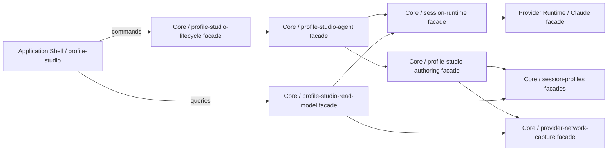

# Profile Studio MVP: implementation planning

Статус: planning document для обсуждения и явного утверждения пользователем.

Дата: 20 июля 2026 года.

Дополнение 21 июля 2026 года: packaged acceptance отменила исходное решение о
фиксированном Claude/Opus creator runtime. Для новых Draft сама creator-сессия
исполняется на provider/model, выбранных в Profile Studio. Текущая runtime
правда находится в `docs/architecture/ProfileStudio.md`; пункты ниже о
фиксированном Claude/Opus сохранены как история исходного planning baseline.

Источники:

- `docs/proposals/ProfileStudio.md`;
- принятый интерактивный прототип
  `.harness/runtime/prototypes/profile-studio-ui/`;
- текущая архитектура `docs/architecture/SessionProfiles.md`;
- live code модулей `session-profiles`, `session-runtime`,
  `provider-network-capture`, `session-interface` и Claude provider.

Документ определяет первый production-срез. До пользовательского утверждения
он не является текущей архитектурой и не разрешает начинать правки production
code. После утверждения принятый контракт должен быть перенесён в
`docs/architecture/**`, отражён в Product Tree и только затем разложен в
новый active implementation plan.

## 1. Подтверждённые решения

Пользователь уже подтвердил следующие решения:

1. Profile Studio является самостоятельным новым кластером со своими
   модулями и facade boundaries. Функциональность не встраивается набором
   локальных веток в `session-window`, Settings или существующий
   `profile-settings-ui`.
2. Чтобы выполнить подтверждённое cluster requirement без нарушения Core
   Authority, этот документ предлагает два одноимённых, но
   Product-Part-scoped кластера: `core-runtime/profile-studio` и
   `application-shell/profile-studio`. Точный split принимается вместе с
   документом в разделе 17.
3. Первый Profile Creator Agent является фиксированным Claude Agent. Целевые
   provider/model создаваемого профиля не определяют provider самого creator
   agent.
4. Первый creator runtime использует Core model id `opus`. Предлагаемый
   начальный reasoning effort — `high`; это остаётся одним коротким решением
   на утверждение данного документа.
5. Центральная колонка переиспользует настоящий Harness AI session interface,
   а не HTML/CSS из прототипа. Прототип определяет композицию и information
   architecture, но не является production source.
6. Profile Studio первого этапа работает только с целевыми provider/model из
   Claude, Codex и Kimi.
7. UI не показывает фиктивные данные и не содержит неработающих controls.
   Отсутствующий функционал представлен Core-backed read-only состоянием или
   вообще не выводится.
8. Пользователь не редактирует profile documents вручную. Все изменения
   проходят через разговор с Profile Creator Agent и валидируемую Core
   authoring boundary.

## 2. Цель первого production-среза

Пользователь должен иметь возможность:

1. одним действием перейти из обычного режима Harness AI в Profile Studio;
2. выбрать target provider и model;
3. увидеть только Studio-профили, совместимые с этой точной парой;
4. начать новый Draft или открыть его сохраняемую creator session;
5. обсудить назначение профиля с фиксированным Claude Profile Creator Agent;
6. получить созданные агентом две читаемые части Custom System Prompt;
7. увидеть честное состояние Custom System Tools и provider ceiling;
8. вручную проверить профиль через обсуждаемые задания;
9. явно утвердить конкретный content hash и получить status `Valid`;
10. увидеть утверждённый профиль в обычном session picker только для
    совместимой пары provider/model.

Первый срез считается вертикальным: shell без creator session, фиктивный
inspector или profile files без работающего применения не являются готовым
результатом.

## 3. Live truth и необходимые изменения

| Область | Что уже есть | Чего не хватает для Studio |
| --- | --- | --- |
| Profile storage | `profile-store` читает `profile.yaml`, `system-prompt.md`, optional `custom-instructions.md`/`tools.json` | model identity, Studio lifecycle metadata и Draft documents |
| Profile catalog | provider-scoped listing и virtual Native | provider+model filter, Studio-only list без Native, Draft/Valid semantics |
| Profile materialization | prompt + custom instructions и immutable content hash | Studio v2 composition без внешнего `AGENTS.md` wrapper |
| Profile authoring | template creation и открытие в VS Code | agent-owned atomic authoring, без external editor |
| Sessions | persisted primary/subagent sessions и обычный session interface | session purpose `profile-creator` и связь с profile id |
| Claude | custom system prompt, managed isolation и JSON Schema output | Studio-specific session configuration и structured draft result |
| Native Capture | capture per provider/model и raw/readable artifacts | validated donor reference/catalog contract; отдельный Capture UI не входит |
| Application Shell | рабочие sidebar, dialog, input, telemetry и Settings | Studio mode, Studio sidebar и right inspector |

Важно: существующий status `Valid` в Settings означает только, что files
синтаксически читаются. Новый Studio status `Valid` означает явное
пользовательское утверждение конкретного content hash. Эти два понятия нельзя
склеивать или выводить из одного boolean.

## 4. Product Part / Cluster / Module placement

### 4.1 Core Runtime cluster

Новый путь:

`product-parts/core-runtime/clusters/profile-studio/`

Кластер владеет Profile Studio workflow truth. Он не исполняет provider
protocol и не рендерит UI.

| Module | Public facade | Ответственность |
| --- | --- | --- |
| `profile-studio-lifecycle` | `ProfileStudioLifecycleFacade` class | Draft identity, profile↔creator-session binding, lifecycle gates, content-hash approval, возврат Valid-профиля в Draft после изменения |
| `profile-studio-agent` | `ProfileStudioAgentFacade` class | fixed Claude/Opus creator configuration, isolated system prompt, structured-output schema, создание/возобновление creator session |
| `profile-studio-authoring` | `ProfileStudioAuthoringFacade` class | validation и atomic application полного draft snapshot, donor binding, запись двух prompt parts и tools через `session-profiles` facades |
| `profile-studio-read-model` | `ProfileStudioReadModelFacade` class | provider/model targets, compatible sessions, Overview/Prompt/Tools snapshots, honest capability/empty states и Studio update events |

Каждый module владеет только своим `module.md` и `src/**`. Внешние callers
импортируют facade, а не внутренние parser/store helpers.

### 4.2 Application Shell cluster

Новый путь:

`product-parts/application-shell/clusters/profile-studio/`

Кластер только передаёт user intents и отображает Core read models.

| Module | Public facade | Ответственность |
| --- | --- | --- |
| `profile-studio-shell` | `ProfileStudioShellFacade` React facade | single-window mode, трёхколоночная композиция, возврат в workspaces/sessions, выбранные UI tab/row |
| `profile-studio-sidebar` | `ProfileStudioSidebarFacade` React facade | provider/model controls, Create Profile, compatible Draft/Valid creator sessions, return action |
| `profile-studio-inspector` | `ProfileStudioInspectorFacade` React facade | `Overview`, `Custom System Prompt`, `Custom System Tools`, read-only Core snapshots и честные empty states |

Application Shell facades следуют текущей React-конвенции проекта и могут
быть facade components, а не React class components. Требование facade
boundary остаётся обязательным.

### 4.3 Reusable session surface

Новый module внутри существующего кластера
`application-shell/session-interface`:

| Module | Public facade | Ответственность |
| --- | --- | --- |
| `session-surface` | `SessionSurfaceFacade` React facade | существующие SessionId, dialog timeline, input, provider interactions и telemetry без sidebar/Settings ownership |

`SessionWindowFacade` и `ProfileStudioShellFacade` используют один
`SessionSurfaceFacade`. Studio не копирует session state hooks, Core event
routing, timers, subagent timeline, Markdown rendering или CSS session cards.

### 4.4 Existing clusters, которые Studio композирует

- `session-profiles` остаётся владельцем физических profile documents,
  parsing, catalog compatibility и materialization;
- `session-runtime` остаётся владельцем session history, messages, provider
  binding и turn lifecycle;
- `provider-network-capture` остаётся владельцем raw capture artifacts;
- `provider-registry/provider-descriptor` остаются единственным источником
  provider/model identity;
- Claude provider остаётся владельцем SDK invocation;
- Core runtime process и preload только экспонируют typed commands/events.

Studio cluster не читает implementation files соседних кластеров и не
дублирует их алгоритмы.

## 5. Зависимости и authority flow



Renderer не:

- сканирует `~/.harness-ai/Profiles`;
- читает capture JSONL/Markdown;
- определяет совместимость provider/model;
- компилирует prompt;
- вычисляет Draft/Valid;
- распознаёт approval из текста пользователя;
- применяет agent output к файлам.

## 6. Profile Studio domain model

Минимальный Core-owned record:

```ts
interface ProfileStudioProfile {
  profileId: string;
  name: string;
  description: string;
  purpose: string;
  target: {
    providerId: "claude" | "codex" | "kimi-client";
    modelId: string;
  };
  lifecycleStatus: "draft" | "valid";
  creatorSessionId: string;
  nativeCaptureDonor: NativeCaptureDonorReference | null;
  contentHash: string;
  approvedContentHash: string | null;
  createdAt: string;
  updatedAt: string;
  approvedAt: string | null;
}
```

### 6.1 Identity до появления окончательного имени

Рекомендация MVP: `Создать профиль` немедленно создаёт immutable
`profileId = draft-<uuid>` и creator session. Пользовательское имя может быть
предложено агентом позже и не меняет internal id или session binding.

Это не revision system и не защита «на будущее». Immutable id нужен уже
сейчас, чтобы восстановить незавершённый Draft после restart и не переименовать
session/history/profile directory атомарно при каждом изменении названия.

### 6.2 Provider/model compatibility

Studio profile совместим только при точном равенстве:

```text
profile.target.providerId == selected.providerId
profile.target.modelId == selected.modelId
```

Provider-only fallback для новых Studio profiles запрещён. Existing legacy
provider-only profiles продолжают читаться старым runtime, но не появляются в
Studio sidebar и не получают выдуманную model identity.

### 6.3 Lifecycle

- новый profile всегда `Draft`;
- незаполненный donor, prompt part или provider capability не ломает Draft;
- `Valid` возможен только для точного текущего `contentHash`;
- approval является прямой Core command с `{ profileId, contentHash }`;
- изменение утверждённого content создаёт новый hash и немедленно возвращает
  profile в `Draft`;
- revision history и rollback не создаются;
- удаление/повреждение recovery не проектируются в этом MVP.

## 7. Physical profile format

Чтобы не создавать второй несовместимый формат, Studio v2 расширяет текущий
profile directory и переиспользует уже доказанную двухчастную сборку:

```text
~/.harness-ai/Profiles/<provider-namespace>/<profileId>/
  profile.yaml
  system-prompt.md
  custom-instructions.md
  tools.json                 # если provider/tool mode это поддерживает
```

Семантика:

- `system-prompt.md` — сокращённая и переформатированная Native-основа;
- `custom-instructions.md` — краткие Custom-дополнения;
- `tools.json` — точный effective/candidate structured tool set или честный
  provider ceiling record;
- `profile.yaml` — паспорт, target identity, lifecycle, creator session и
  donor provenance.

Минимальное Studio v2 расширение `profile.yaml`:

```yaml
schemaVersion: 2
authoring: profile-studio
name: Planning Documents
description: Draft profile for planning-document work
provider: claude
model: opus
status: draft
creatorSessionId: session-claude-...
nativeCaptureDonor: null
```

Compiled system prompt не хранится третьим editable документом. Его
детерминированно собирает `profile-materializer` из двух частей в фиксированном
порядке. Для Studio v2 materializer не добавляет workspace `AGENTS.md`, Skills
или прежний generic workflow wrapper.

Existing v1 profiles остаются читаемыми без автоматической destructive
migration. Их schema-validity не превращается автоматически в Studio `Valid`.

## 8. Fixed Claude Profile Creator Agent

### 8.1 Runtime identity

- provider: `claude`;
- model: `opus`;
- proposed reasoning: `high`;
- session workspace id: reserved Core id `profile-studio`;
- isolated workspace path:
  `~/.harness-ai/ProfileStudio/workspace` (`HARNESS_AI_HOME` aware);
- `settingSources: []`;
- no workspace `AGENTS.md`, `CLAUDE.md`, Skills or ambient user instructions;
- no filesystem/shell/web tools in the initial authoring route.

Профиль создаётся агентом не через unrestricted filesystem tools. Claude
получает current draft, selected target, donor content и authoring rules inline
в своём system prompt, а результат каждого turn возвращает через JSON Schema
structured output.

### 8.2 Structured authoring boundary

Предлагаемый result contract:

```ts
interface ProfileCreatorTurnResult {
  assistantResponse: string;
  draft: null | {
    name: string;
    description: string;
    purpose: string;
    systemPrompt: string;
    customInstructions: string;
    toolSelection: ProfileStudioToolSelection;
    donorReference: ProposedDonorReference | null;
  };
  nextAction: "continue" | "request-approval";
}
```

Правила:

1. `assistantResponse` попадает в обычную assistant bubble.
2. `draft: null` означает, что turn был только обсуждением.
3. Непустой `draft` является полным candidate snapshot, а не неоднозначным
   text patch.
4. `ProfileStudioAuthoringFacade` валидирует весь snapshot и только затем
   атомарно пишет документы.
5. Невалидный structured result не меняет файлы; Core публикует controlled
   session notice и agent получает repair turn.
6. Agent не может самостоятельно присвоить `Valid`.
7. `request-approval` создаёт Core-owned approval interaction в центральной
   сессии. Только прямой выбор пользователя отправляет approval command.

Эта схема является более узкой authoring boundary, чем выдача Claude
filesystem tools: модель предлагает полный state, а Core решает, допустимо ли
его применить.

### 8.3 Persistent creator session

В `CoreSession` добавляется отдельное optional purpose metadata, а не новое
значение structural `sessionKind`:

```ts
sessionPurpose?: {
  type: "profile-creator";
  profileId: string;
};
```

`sessionKind` продолжает означать только `primary`/`subagent`. Creator session
использует обычную message/event/provider pipeline и восстанавливается из
dedicated Profile Studio workspace session index.

## 9. Native Capture donor в MVP

Отдельный Capture interface не входит в первый production-срез.

Функциональный временный путь:

1. Draft создаётся с `nativeCaptureDonor: null`.
2. Agent просит пользователя указать существующий capture artifact, если он
   нужен для следующего шага.
3. Пользователь может вставить путь к capture в диалог.
4. Structured result предлагает donor reference.
5. Core принимает только artifact внутри известного Native Capture root,
   читает raw JSONL как truth, проверяет provider/model/capture id и сохраняет
   immutable provenance + request hash.
6. Overview показывает «Основан на Native Capture» или честное «Donor ещё не
   выбран».

Это не окончательный UX выбора capture. После отдельного обсуждения path-in-
dialog будет заменён Capture catalog/interface без изменения profile record.

## 10. Custom System Tools contract первого среза

Tools tab всегда отображает Core read model, но provider capabilities разные:

| Target | MVP behavior | Возможность `Valid` |
| --- | --- | --- |
| Claude | Agent выбирает сокращённый subset Native tool ids; Core сверяет с donor inventory; Claude adapter применяет поддерживаемый whitelist | Да, после prompt/tools validation и user approval |
| Codex | Tools показываются как provider-fixed read-only set; Studio изменяет только prompt | Да, с явным ceiling `fixed` |
| Kimi | Draft может содержать candidate 25-tool Native inventory, но current universal client имеет только 9 registered builtin executors | Нет до отдельного 25-tool parity slice |

Нельзя помечать Kimi profile `Valid`, если UI показывает 25 tools, а runtime
исполняет только 9. Studio показывает blocking capability reason из Core.

Создание новых executable tools, изменение captured schemas/descriptions и
универсальный cross-provider tool vocabulary в MVP не входят.

## 11. Application Shell contract

### 11.1 Mode switch

- `Profile Studio` располагается рядом с `Settings` в обычном sidebar;
- одно нажатие меняет назначение main window;
- Studio sidebar показывает `Вернуться к рабочим пространствам и сессиям`;
- Settings modal не используется как entry point;
- detached session windows не получают Studio mode.

### 11.2 Sidebar

- provider list: только Claude, Codex, Kimi из Core;
- model list: Core `provider-descriptor` catalog;
- profile list: только exact provider+model Studio records;
- raw Native profile/capture не показывается;
- Studio-managed Synthetic Native может отображаться как обычный profile;
- `Создать профиль` всегда создаёт Draft + creator session либо показывает
  Core error, например Claude creator unavailable.

### 11.3 Center

Центр использует `SessionSurfaceFacade` без визуального расхождения с обычной
сессией. Studio не имеет собственного renderer сообщений, input, reasoning,
tools, subagents, timer или telemetry.

### 11.4 Inspector

Tabs:

1. `Overview`;
2. `Custom System Prompt`;
3. `Custom System Tools`.

Prompt показывает отдельно реальные `system-prompt.md` и
`custom-instructions.md`. Изменения обсуждаются через composer; inspector не
имеет textarea/editor.

Tools показывает actual/candidate set, control mode (`subset`, `fixed`,
`blocked`) и capability reason. Capture tab отсутствует.

### 11.5 Honest states

Допустимы:

- «Выберите или создайте профиль»;
- «Agent ещё не сформировал Native-основу»;
- «Custom-дополнения пока отсутствуют»;
- «Native Capture donor не выбран»;
- «Kimi validation заблокирован: 9/25 executors implemented».

Недопустимы mock percentages, fake scores, случайные даты/capture ids и
disabled buttons без Core-provided причины.

## 12. RPC и event surface

Имена окончательно фиксируются при promotion в architecture, но MVP требует
следующие typed intents:

- `listProfileStudioTargets()`;
- `listProfileStudioProfiles({ providerId, modelId })`;
- `getProfileStudioProfile({ profileId })`;
- `createProfileStudioDraft({ providerId, modelId })`;
- `sendProfileStudioMessage({ profileId, text })` или обычный `sendMessage`
  после Core resolution session id;
- `approveProfileStudioDraft({ profileId, contentHash })`;
- `listProfileStudioSessionEvents({ creatorSessionId })` через существующую
  session surface;
- event `profile-studio:updated` с profile id и revisionless update reason.

Create/list/get/approve truth живёт в Core cluster. Preload проверяет payload
shape, но не принимает lifecycle decisions.

## 13. Existing Profile Creator migration

Первый implementation не удаляет profile files и не переписывает existing v1
directories.

Переход:

1. во время промежуточных implementation slices новый Profile Studio workflow
   может временно сосуществовать со старым Settings authoring surface;
2. Studio listing показывает только Studio v2 records;
3. existing v1 profiles продолжают работать в обычных sessions;
4. в package, передаваемом на итоговую пользовательскую приёмку нового
   create/open/approve workflow, старый Settings tab `Profile Creator` уже
   удалён как authoring entry point;
5. legacy profiles остаются readable runtime data, но не получают
   creator-session identity или Studio `Valid` автоматически;
6. отдельная manual migration существующего synthetic profile возможна позже,
   но не входит в MVP.

Так мы не смешиваем две модели и не выдаём schema-valid legacy profile за
пользовательски утверждённый Studio profile.

## 14. Implementation sequence после принятия документа

### Slice A — architecture promotion

- создать accepted `docs/architecture/ProfileStudio.md`;
- согласовать изменения `docs/architecture/SessionProfiles.md`;
- добавить оба `profile-studio` clusters и modules в Product Tree;
- создать новый implementation plan.

### Slice B — Core lifecycle and v2 documents

- cluster/module skeletons с class facades;
- Studio v2 passport parsing/storage;
- provider+model catalog;
- Draft/Valid + content hash lifecycle;
- legacy compatibility tests.

### Slice C — persistent Claude creator session

- dedicated Profile Studio workspace;
- session purpose/profile binding;
- fixed Claude/Opus isolated system prompt;
- JSON Schema structured result;
- atomic authoring and repair path.

### Slice D — Core read model and bridge

- targets/profile/inspector snapshots;
- typed RPC;
- `profile-studio:updated` events;
- approval interaction and command.

### Slice E — reusable SessionSurface

- extract current central session composition without visual change;
- ordinary Session Window consumes the new facade;
- regression tests preserve existing sessions before Studio consumes it.

### Slice F — Application Shell Profile Studio cluster

- mode switch;
- Studio sidebar;
- central reused session;
- Overview/Prompt/Tools inspector;
- accepted prototype proportions adapted to existing design tokens.

### Slice G — provider target capability gates

- Claude prompt + subset tool application;
- Codex prompt-only/fixed-tools behavior;
- Kimi Draft-only blocking state until 25-tool parity.

### Slice H — packaged acceptance

- `npm run package:mac` only after explicit user confirmation;
- restart packaged app;
- user executes the end-to-end checklist below.

Каждый implementation task и commit будет ограничен не более чем тремя
functional files, с синхронным обновлением module/cluster/product-part docs,
Product Tree и architecture documents.

## 15. Acceptance checklist первого production-среза

1. Обычное окно и session UI визуально и функционально не регрессировали.
2. Profile Studio открывается одной кнопкой и возвращается обратно.
3. Studio работает в том же окне и не открывает Settings/second window.
4. Provider/model controls содержат только Core truth Claude/Codex/Kimi.
5. Create создаёт один Draft и одну persistent Claude creator session.
6. Restart приложения восстанавливает profile↔session связь и transcript.
7. Разговор с agent обновляет реальные две prompt parts через Core, без VS
   Code/manual editing.
8. Inspector обновляется по Core event и не читает files в renderer.
9. Invalid structured output не повреждает предыдущий draft.
10. `Valid` присваивается только прямой approval command для текущего hash.
11. Edit после approval возвращает status в `Draft`.
12. Valid Claude/Codex profile появляется только у exact target model в
    обычном picker и реально применяет prompt.
13. Codex Tools честно показываются fixed.
14. Kimi Draft можно обсуждать, но validation честно blocked до 25/25 parity.
15. Raw Native Captures не появляются как profile rows.
16. Profile Creator Agent не получает workspace `AGENTS.md`, Skills или
    unrestricted filesystem tools.
17. Custom Capture, benchmark и Normalizer нигде не симулируются.

## 16. Риски, которые проверяются первыми

1. Claude structured output должен одновременно давать нормальный
   `assistantResponse` для dialog и валидный full draft snapshot.
2. Existing provider adapter session resume не должен потерять Studio-specific
   output schema после restart.
3. Выделение `SessionSurfaceFacade` не должно изменить обычный session CSS,
   timing, interactions или event subscription.
4. Current profile store scanner должен поддержать v2 без изменения behavior
   v1 profiles.
5. Provider/model picker должен использовать один Core catalog; Kimi target id
   в Studio — `kimi-client`, а capture provider identity может оставаться
   `kimi` внутри donor provenance.

## 17. Решения, которые пользователь принимает вместе с документом

Предлагается утвердить:

1. два Product-Part-scoped `profile-studio` clusters вместо одного
   cross-boundary cluster;
2. перечисленные четыре Core modules и три Application Shell modules;
3. отдельный reusable `session-surface` module;
4. fixed creator runtime `claude` / `opus` / `high`;
5. structured full-snapshot output вместо filesystem authoring tools;
6. immutable `draft-<uuid>` profile id с редактируемым display name;
7. сохранение текущих имён `system-prompt.md` и
   `custom-instructions.md` как двух source parts;
8. temporary donor-path-through-dialog до отдельного Capture interface;
9. Claude Valid, Codex prompt-only Valid и Kimi Draft-only capability gate;
10. removal старого Settings Profile Creator из итогового acceptance package
    после того, как новый workflow функционально завершён, но до его ручной
    приёмки.

## 18. Что не блокирует начало после принятия

Не требуется до первого implementation plan:

- спецификация отдельного Capture interface;
- benchmark и formal behavioral scoring;
- Normalizer;
- revision history/rollback;
- automatic capture drift updates;
- первый reusable task-class skeleton;
- user task внутри system prompt;
- Kimi 25-tool implementation — Studio foundation может показывать честный
  Draft-only gate до отдельного parity slice.
