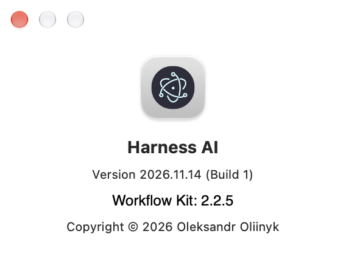

# Workflow Kit 2.2.5 synchronization evidence

Date: 2026-11-14. Scope: `application-versions-about-2026-11-13`, round R2.
Specification: [WorkflowKitSync-2.2.5-2026-11-14.md](../architecture/WorkflowKitSync-2.2.5-2026-11-14.md).
Execution: sequential, autonomously, as instructed by the user.

## Source parity

- Donor Kit commit: `696e95c4f03bd65994ffd349dd751d8f9696a51e` (M31, `scope:owner`).
- Donor HEAD at the start: `324ec80`; during the work it moved to `7bead3af`
  (`accept`, `close` and its own Kit update). No Kit source changed after `696e95c4`.
- Donor source digest recomputed with the donor algorithm:
  `f12d1abc2bb7d9916a7b23d8d65a3ac7094d5c605e7e095984f20bdafa22099b`;
  it equals `KIT_SOURCE_DIGEST` of the donor bundle 2.2.5.
- File-by-file comparison of all 13 donor modules before the transfer: apart
  from the documented 2.2.4 adaptations and `test/**` → `src/**` imports,
  only the `696e95c4` changes differed.
- Transferred: `plan-owner.ts`, `kit-scope-owner.ts`, the `scope:owner` CLI
  entry, both facade methods, `workflow-kit-owner.test.mjs`, `KIT_VERSION`.
- Commits: T006 `b3b6895f`, T007 `30a18290`, DOCS-R2 `92dfc212`; each
  passed the full commit profile. Biome reformatted four transferred files.
- Harness sources: 109 TypeScript files, as in the donor.

## Installed repository Kit

- Previous installed version: 2.2.4 (runtime `ee444535…cced6`). Current: **2.2.5**.
- Bundle built by `npm run build:workflow-kit` (Vite) from the synchronized sources.
- The update ran through the new bundle CLI:
  `node dist/workflow-kit/workflow.mjs install . --update --host harness --bundle dist/workflow-kit/workflow.mjs`;
  previous state `KIT_OUTDATED`, written runtime and manifest only.
- Installer service commit: `cbacef35ebbaff366ab65fbf850066cd0124aefb`.
- Runtime, built bundle and manifest hash:
  `40772460544df80536f9fc1ca9bad11eb252e9a58f4170a34f5a0841c48a4587`.
  The donor esbuild bundle (`6f4fab8d…`) differs by builder, as in 2.2.4.
- `doctor` and `validate` return `ok: true`; `status`, `recover` and
  `help` (with `scope:owner`) work with the installed CLI.
- The active scope, T008 in progress and revision 250 survived the update;
  the installer excluded the plan from its commit. No managed file was edited by hand.

## SessionStart hook protocol

- Codex packet: 26261 UTF-8 bytes.
- Claude: three non-empty parts of six (8257, 8120, 2854 UTF-16 units),
  one digest `7906c8d60dab`; parts 4–6 are empty continuations. Without
  their header lines the parts reassemble to the Codex packet length.
- These are hook-output checks; a new live provider session was not started.

## macOS package verification (T009)

- `npm run quality`: passed, `Tests: OK (232)`; `check:dup`, `check:security`
  (zero vulnerabilities) and `check:links` passed.
- The tag was chosen before packaging: **v2026.11.14** (free on origin).
  `npm run build` and `HARNESS_RELEASE_TAG=v2026.11.14 npm run package:mac`
  passed with signing disabled; source HEAD `2c0a821a`.
- Package: `release/mac-arm64/Harness AI.app`. Build descriptor from the real
  app.asar: release `2026.11.14`, build `1`, tag `v2026.11.14`; packaged
  package.json and Info.plist: `2026.11.14`, `CFBundleVersion` `1`.
- app.asar SHA-256: `0ba8912b065a468599421f81a48eaa640d11c98cfd53fd183945ce05ac557bfe`.
- Packaged Kit SHA-256 equals the repository Kit:
  `40772460544df80536f9fc1ca9bad11eb252e9a58f4170a34f5a0841c48a4587`.
- An isolated profile, Harness home and Git config ran the packaged app;
  the renderer came from app.asar, preload and Core were available, New
  Project opened its dialog, Core `get-product-info` returned
  `2026.11.14` and Workflow Kit `2.2.5` without a workspace.
- Through preload/Core a new project received Kit 2.2.5; status and Doctor
  passed. Selecting a project with an older installed Kit 2.1.1 left the
  product info unchanged. No renderer exceptions; test processes stopped.

The native About panel was opened from the app menu by macOS accessibility
for the spawned PID and captured as its CoreGraphics window:

It reads `Version 2026.11.14 (Build 1)` and `Workflow Kit: 2.2.5`.
Closing About kept Core available.

## GitHub publication

Appended by the delivery task T010.
