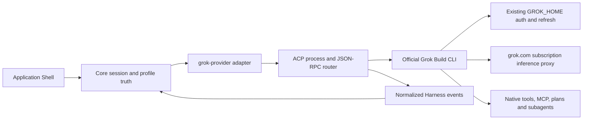

# Grok Provider Integration Plan — 2026-07-16

## Статус документа

- **Тип:** исследовательское evidence + план реализации.
- **Текущий scope:** документ является baseline активного implementation scope `grok-provider-implementation-2026-07-16`; реализация выполняется по `.harness/plans/todo-plan.md` до нового package build.
- **Цель implementation scope:** добавить в Harness AI нативный провайдер `grok`, который использует установленный официальный Grok Build CLI и существующую подписочную авторизацию пользователя, поддерживает Native/Managed session profiles, модели, reasoning, системный промпт, нативный туллинг, MCP, разрешения, сессии, usage и субагентов.
- **Основное решение:** интеграция через официальный ACP stdio-канал `grok agent stdio`.
- **Обязательная UI-граница:** функциональность Grok session interface должна быть идентична Codex; особенно нижняя status panel обязана получать из Core все Codex-поля и действия без Grok-specific упрощений.

## 1. Решение Кратко

Harness AI должен получить отдельный нативный `grok-provider`, аналогичный по ownership нативным Claude/Codex-адаптерам. Grok не следует добавлять в Universal Client: OpenAI-совместимый прямой API не использует подписочную авторизацию SuperGrok и теряет нативный Grok Build harness — его сессии, инструменты, MCP, permission lifecycle, планы и субагентов.

Целевой маршрут:



Принципиальные границы:

- Core владеет выбором провайдера, профиля, модели, reasoning и неизменяемым applied profile snapshot.
- `grok-provider` владеет переводом Core-контрактов в ACP/Grok-форму и обратно.
- Grok CLI владеет OAuth-токеном, его обновлением, нативными сессиями, tool execution, MCP и provider-specific состоянием.
- Renderer ничего не выводит из текста Grok-сообщений и не читает `~/.grok` напрямую.
- Секреты из `auth.json` не копируются в Harness settings, session logs, diagnostics или renderer.

## 2. Проверенные Факты

### 2.1 Локальная установка и подписка

Проверено 2026-07-16 на текущем Mac:

- бинарь: `/Users/oleksandroliinyk/.grok/bin/grok`;
- версия: `grok 0.2.101 (5bc4b5dfadcf) [stable]`;
- ACP запускается через `grok agent stdio`;
- `initialize` объявляет методы авторизации `cached_token` и `grok.com`;
- `cached_token` успешно использует существующую browser/OIDC-сессию;
- live billing extension распознаёт подписку как `SuperGrok`;
- usage period — недельный (`USAGE_PERIOD_TYPE_WEEKLY`);
- live ответ содержит время следующего сброса, но в текущей форме не содержит процента использованного лимита;
- текущий provider home — `~/.grok`; CLI сам владеет auth refresh и хранением сессий.

Официальная документация подтверждает, что Grok Build поддерживает browser authentication, headless-режим и ACP-интеграцию: [Grok Build overview](https://docs.x.ai/build/overview), [Headless and ACP](https://docs.x.ai/build/cli/headless-scripting).

### 2.2 Доступные модели

Live `grok models` и локальный model cache на момент исследования показывают:

| Модель | Текущий статус | Контекст | Reasoning |
| --- | --- | ---: | --- |
| `grok-4.5` | default | 500k | `low`, `medium`, `high`; default `high` |
| `grok-composer-2.5-fast` | available | 200k | выбор effort не объявлен |

Этот список является runtime truth, а не продуктовым hardcode. Адаптер должен получать каталог динамически и публиковать Core-нормализованный read model.

### 2.3 Системный промпт

Поддерживаются два разных контракта:

- `rules` / `--rules` добавляет правила к vendor prompt;
- `systemPromptOverride` / `--system-prompt-override` полностью заменяет vendor system prompt.

Публичный исходник применяет непустой session-level `systemPromptOverride` дословно; при `session/load` он может заменить system head уже существующей сессии. `rules` применяется только при создании и не синхронизируется на resume. Источник: [ACP system prompt implementation](https://github.com/xai-org/grok-build/blob/c68e39f60462f28d9be5e683d9cbe2c57b1a5027/crates/codegen/xai-grok-shell/src/agent/mvp_agent/mod.rs#L1006-L1080).

Для текущего Harness Session Profiles v1 режим Managed означает полную замену, поэтому целевой mapping:

- `Native` → не передавать `systemPromptOverride` и не добавлять Harness prompt;
- `Managed` → передать замороженный `SessionProfilePayload.prompt` через session-level `systemPromptOverride`;
- applied snapshot → сохранить hash и provider-specific подтверждение фактически выбранного механизма.

### 2.4 Agent profile и нативный туллинг

ACP `_meta.agentProfile` принимает имя существующего агента или JSON-объект. Публичный формат включает:

- `name` и `description`;
- `promptMode` и `promptBody`;
- `tools` и `disallowedTools`;
- `permissionMode`;
- `skills`;
- `agentsMd`;
- tool-specific configuration и output format.

Источник: [AgentDefinition ACP JSON contract](https://github.com/xai-org/grok-build/blob/c68e39f60462f28d9be5e683d9cbe2c57b1a5027/crates/codegen/xai-grok-agent/src/config.rs#L1594-L1614).

CLI также публично объявляет `--tools`, `--disallowed-tools`, permission rules, sandbox, `--no-plan`, `--no-subagents`, `--no-memory` и `--disable-web-search`: [CLI reference](https://docs.x.ai/build/cli/reference).

Критический риск: публичная реализация сохраняет полный Grok toolset, если allowlist содержит неразрешимые имена. Поэтому адаптер не может приблизительно угадывать tool IDs. Он должен:

1. иметь версионированный каталог известных Grok tool IDs и aliases;
2. первым implementation probe получить фактический tool inventory установленной версии;
3. компилировать `tools`/`disallowedTools` только из проверенных имён;
4. сохранять requested и effective toolset в applied profile details;
5. падать видимой structured error при невозможности доказать managed binding, а не молча стартовать с полным набором.

Источник fail-open поведения: [Grok tool allowlist implementation](https://github.com/xai-org/grok-build/blob/c68e39f60462f28d9be5e683d9cbe2c57b1a5027/crates/codegen/xai-grok-agent/src/builder.rs#L900-L940).

### 2.5 MCP, permissions, plans и subagents

- MCP является нативной частью Grok Build; server tools имеют имена `<server>__<tool>` и доступны рядом со built-in tools: [MCP Servers](https://docs.x.ai/build/features/mcp-servers).
- ACP использует blocking reverse requests для tool permissions, ask-user и plan approval.
- Публичный исходник содержит extensions для list/get/cancel Grok subagents, включая parent/child session IDs, статус, прогресс, модель и usage.
- Harness уже имеет provider-neutral `subagent_control`, `subagent_session` и `subagent_status`, поэтому Grok subagent events должны нормализоваться в существующий Core/UI lifecycle, а не создавать отдельную Grok-ветку UI.

### 2.6 Billing и usage

Публичный исходник содержит `x.ai/billing` extension с:

- subscription tier;
- `creditUsagePercent`;
- weekly/monthly current period;
- period end;
- on-demand и prepaid credit fields;
- unified billing marker.

Источник: [Grok billing extension](https://github.com/xai-org/grok-build/blob/c68e39f60462f28d9be5e683d9cbe2c57b1a5027/crates/codegen/xai-grok-shell/src/extensions/billing.rs#L60-L130).

Live версия 0.2.101 подтверждает доступность extension на wire как `_x.ai/billing`, но её JSON отличается от сегодняшнего snapshot исходника:

- tier приходит как `subscription_tier`, тогда как новый source contract использует `subscriptionTier`;
- weekly period и reset доступны;
- usage percentage отсутствует.

Следствие: billing decoder должен быть additive и принимать обе формы. Недоступный процент отображается как `unknown`, а не как `0%`.

Официально SuperGrok использует общий недельный consumer pool для Grok-продуктов. xAI API имеет отдельный billing: [Grok subscription FAQ](https://docs.x.ai/grok/faq), [Grok and API billing separation](https://docs.x.ai/console/faq/accounts).

### 2.7 Live ACP contract probe для Codex UI parity

Повторный sanitized probe 2026-07-16 на установленном `grok 0.2.101` доказал полный набор источников для нижней Codex-панели:

- `session/new` возвращает dynamic `models`: `grok-4.5` с контекстом `500000` и усилиями `low`/`medium`/`high`, а также `grok-composer-2.5-fast` с контекстом `200000`;
- session-level `systemPromptOverride` записался в `system_prompt.txt` дословно; marker equality проверен без вывода prompt/auth contents;
- минимальный `_meta.agentProfile` с `tools: ["Read"]`, `agentsMd: false` и `discoverSkills: false` применился как `agentName: harness-capability-auditor`;
- effective tool inventory в controlled probe состоял ровно из `read_file`, `search_tool`, `use_tool`; `x.ai/session/info` подтвердил `toolDefinitionsCount: 3` вместо полного набора из `25`;
- installed wire использует `session/set_model` и принимает `_meta.reasoningEffort`; persisted summary подтвердил `reasoning_effort: low` после выбора `low`;
- более новый public snapshot использует `session/setModel`, поэтому adapter обязан capability-probe/fallback между этими двумя method spellings;
- `session/prompt` response `_meta` вернул `totalTokens`, `inputTokens`, `outputTokens`, `cachedReadTokens` и `reasoningTokens`; controlled turn дал ненулевой `cachedReadTokens`;
- `_x.ai/session/info` вернул model, agent name, `context.used`, `context.total`, `context.usagePct`, `context.turnCount`, tool counts и текущий turn index;
- `_x.ai/rewind/points` вернул native prompt checkpoints, а public extension contract содержит `_x.ai/rewind/execute` с `conversation_only`, `files_only` и `all`;
- `_x.ai/billing` подтвердил `SuperGrok`, weekly period и reset при отсутствии процента usage.

Критическая поправка к исходному исследованию: сложный `agentProfile` с `promptMode: full` без собственного `promptBody` не должен использоваться вместе с отдельным `systemPromptOverride`. На live binary это привело к fallback на полный toolset. Доказанный Managed binding использует отдельный полный `systemPromptOverride` и минимальный валидный `agentProfile` без `promptMode`; effective tool count проверяется через `x.ai/session/info`, а не предполагается по request payload.

## 3. Рассмотренные Варианты

| Вариант | Подписка SuperGrok | Нативные возможности | Решение |
| --- | --- | --- | --- |
| Official CLI + ACP stdio | Да | Сессии, tools, MCP, permissions, plans, subagents, billing | **Принят** |
| Headless `streaming-json` per turn | Да | Частичная event fidelity, слабый reverse-request lifecycle | Диагностический fallback |
| Direct `api.x.ai/v1/responses` | Нет, отдельный API billing | Собственный agent loop и tools Harness | Возможный отдельный будущий provider ID |
| Прямой вызов `cli-chat-proxy.grok.com` с OAuth token | Технически использует подписку | Требует копирования секретов и повторения private contract | Запрещён как основной маршрут |
| Встраивание или fork Rust-кода `grok-build` | Возможно по Apache 2.0 | Максимальный контроль | Не оправдан для первого implementation scope |

Почему Universal Client не подходит:

- его ownership — OpenAI-shape API providers;
- SuperGrok и xAI API billing разделены;
- direct API потеряет vendor agent harness;
- Harness пришлось бы заново реализовать Grok tools, MCP, permissions, session persistence, compaction, plans и subagents.

## 4. Целевая Архитектура

### 4.1 Новый модуль

Целевой module root:

`product-parts/provider-runtime/clusters/provider-adapters/modules/grok-provider/`

Предлагаемая внутренняя декомпозиция, без файлов больше 500 строк:

| Файл/группа | Ownership |
| --- | --- |
| `grok-provider-facade.ts` | Публичный facade и сборка адаптера |
| `grok-provider-adapter.ts` | Реализация `ProviderAdapter`, session map и lifecycle |
| `grok-cli-locator.ts` | GUI-safe поиск binary/home и version probe |
| `grok-acp-process.ts` | Spawn/stop, stderr discipline, restart boundary |
| `grok-acp-router.ts` | NDJSON JSON-RPC ids, pending requests, notifications, reverse requests |
| `grok-acp-contracts.ts` | Минимальные используемые wire-типы и version-tolerant decoders |
| `grok-session-runtime.ts` | `session/new`, `session/load`, prompt, cancel, close |
| `grok-profile-application.ts` | Native/Managed mapping и applied details |
| `grok-tool-inventory.ts` | Версионированные tool IDs, aliases и категории |
| `grok-event-normalizer.ts` | ACP chunks/tool calls/usage/plan → Core events |
| `grok-subagent-normalizer.ts` | Grok child sessions → provider-neutral subagent events |
| `grok-billing-client.ts` | `_x.ai/billing` schema normalization |

Декомпозиция является стартовой картой, а не разрешением создать абстракции заранее. Файл появляется только в той микро-задаче, где у него есть фактический контракт и тест.

### 4.2 Process topology

Начальная политика — **один Grok ACP process на одну Harness runtime session**.

Причины:

- immutable изоляция profile/tooling/model/effort;
- отсутствие cross-session contamination;
- простое уничтожение процесса при session close;
- независимая обработка blocking permissions;
- Grok subagents остаются внутри lifecycle родительской Harness-сессии;
- resume поднимает новый процесс и выполняет `session/load` с сохранённым provider session ID.

Shared leader/WebSocket server не входит в первую реализацию. Его можно рассматривать только после измерения process startup, RAM и количества параллельных сессий.

### 4.3 Binary и provider home

Порядок поиска binary:

1. явная Core setting/provider config, если такая настройка будет согласована;
2. `${GROK_HOME}/bin/grok`, когда `GROK_HOME` задан;
3. `${os.homedir()}/.grok/bin/grok`;
4. PATH lookup как fallback.

Продукт не hardcode-ит `/Users/oleksandroliinyk`. Текущий путь используется только как live evidence.

Process environment:

- наследует реальный `GROK_HOME` или нативный `~/.grok`;
- не копирует auth-файл;
- запускается с `--no-auto-update`, чтобы provider process не менял бинарь во время Harness-сессии;
- получает workspace cwd явно;
- не выводит auth/env values в logs;
- запускается без release/package mutation.

### 4.4 ACP lifecycle

Минимальный жизненный цикл:

1. spawn `grok --no-auto-update agent stdio`;
2. `initialize` с поддерживаемыми client capabilities;
3. выбрать `cached_token`, если он доступен;
4. `authenticate`;
5. create: `session/new`; resume: `session/load`;
6. применить модель и reasoning через объявленный ACP model state;
7. `session/prompt` для каждого turn;
8. принимать `session/update` до terminal stop reason;
9. отвечать на permission/ask-user/plan reverse requests;
10. close/cancel и завершить process без orphan tasks.

Router обязан:

- поддерживать числовые request IDs;
- разделять responses, notifications и reverse requests;
- иметь timeout/cancellation на каждый pending request;
- завершать все pending promises при process exit;
- хранить stderr как bounded diagnostic tail;
- не пытаться классифицировать assistant/reasoning/tooling по тексту.

### 4.5 Provider adapter mapping

| Harness contract | Grok implementation |
| --- | --- |
| `initialize` | binary/version/auth/model capability probe |
| `createSession` | ACP process + auth + `session/new` |
| `resumeSession` | ACP process + auth + `session/load` |
| `sendMessage` | `session/prompt`, selected turn options |
| `subscribe` | normalized `session/update` and extension events |
| `closeSession` | cancel active turn, close native session when supported, stop process |
| `deleteSessionArtifacts` | Grok-owned supported delete path; never raw recursive delete without validated mapping |
| `refreshUsageLimits` | billing extension + context/token usage normalization |
| `rollbackSessionTurns` | Grok rewind extension only after a live contract probe |
| `captureNativeRequest` | deferred research slice; не имитировать capture через readable session log |

## 5. Session Profiles Contract

### 5.1 Native

Native должен означать реальный vendor default:

- не передавать custom system prompt;
- не передавать custom agent profile;
- не фильтровать vendor tools;
- не отключать MCP/plan/subagents/memory без отдельной process policy;
- разрешить Grok обнаружить workspace `AGENTS.md`, `.grok` и совместимые provider instructions;
- зафиксировать в applied snapshot версию CLI, модель, reasoning и то, что profile binding отсутствовал намеренно.

### 5.2 Managed

Managed применяется один раз при create:

```json
{
  "systemPromptOverride": "<frozen SessionProfilePayload.prompt>",
  "agentProfile": {
    "name": "harness-<profile-id>",
    "description": "Harness managed session profile",
    "tools": ["<verified Grok or Claude-compatible aliases>"],
    "disallowedTools": ["<verified denied ids>"],
    "agentsMd": false,
    "discoverSkills": false
  }
}
```

`systemPromptOverride` является единственным prompt truth; `promptMode` и `promptBody` не дублируют его. После `session/new` adapter обязан вызвать `x.ai/session/info` и доказать expected agent name и effective tool-definition count. Несовпадение является structured profile-application failure.

`agentsMd: false` предлагается для Managed, чтобы workspace instruction discovery не создавала второй, незафиксированный слой prompt truth. Если профильный контракт позже явно разрешит provider discovery, это оформляется отдельным архитектурным решением.

### 5.3 Tool mapping

Текущий provider-neutral словарь категорий:

- `file-read`;
- `file-write`;
- `shell`;
- `web`;
- `git`;
- `tests`.

Целевой Grok mapping фиксируется после live inventory probe. До этого документ не объявляет догадки фактическим контрактом.

Предварительная семантика:

- отдельные Grok file/search tools → `file-read`;
- edit/write/apply tools → `file-write`;
- terminal tool → `shell`;
- web/backend search tools → `web`;
- git/tests без отдельных native tools следуют за `shell`;
- `Agent`/subagent spawn контролируется отдельным capability flag и profile selection;
- MCP tools не смешиваются с built-in category mapping без явного profile contract.

## 6. Permissions и Security

Максимально функциональный provider не должен постоянно использовать `--always-approve`.

Целевое поведение:

- Grok отправляет ACP permission reverse request;
- Core преобразует его в provider-neutral pending interaction;
- Application Shell показывает in-app разрешение;
- решение пользователя возвращается тому же ACP request;
- deny/timeout завершают tool call предсказуемо;
- выбранный sandbox и permission mode принадлежат Core/session snapshot, а не renderer inference.

Временный `always-approve` допустим только в раннем вертикальном probe и не считается завершённой реализацией провайдера.

Security requirements:

- никогда не читать или сериализовать raw bearer token без необходимости;
- не копировать `auth.json` в workspace;
- redact authorization, cookies, refresh tokens и account identifiers;
- не показывать raw stderr пользователю без safe normalizer;
- не разрешать renderer вызывать произвольный ACP extension;
- allowlist поддерживаемых extension methods находится в Core provider module;
- project MCP и hooks подчиняются Grok trust/policy lifecycle.

## 7. Event Normalization

Адаптер должен использовать ACP discriminators и structured payloads.

| Grok event | Harness result |
| --- | --- |
| agent message chunk | assistant content delta |
| thought/reasoning chunk | reasoning delta |
| tool call / update | normalized tool lifecycle event |
| plan | Core-owned plan/read model event |
| token/context usage | provider usage snapshot |
| permission request | pending interaction |
| ask-user request | in-app question interaction |
| subagent spawn/list/get | `subagent_control` + `subagent_session` |
| subagent progress/terminal | child-channel `subagent_status` |
| process exit | structured provider session failure unless expected close |

Readable Grok `updates.jsonl` и `chat_history.jsonl` являются provider-owned diagnostics/history, но live Core state идёт из текущего ACP connection. File tailing используется только как recovery fallback после доказанного gap, а не как основной event channel.

## 8. Codex-Equivalent Session Interface Contract

### 8.1 Общий session shell

Grok использует тот же provider-neutral session shell, что Codex. Функциональная идентичность включает:

- session ID и immutable applied-profile chip;
- provider usage-limit rows в верхней панели;
- assistant, reasoning/thinking, tool lifecycle, plan и subagent timeline;
- stop/cancel текущего turn;
- elapsed session time;
- resume и восстановление provider session ID;
- нижнюю status panel с теми же chips, порядком данных, состояниями и действием Rollback.

Не допускается отдельная упрощённая Grok-панель. Отличаться могут только provider-owned значения, названия моделей и поддерживаемые reasoning efforts.

### 8.2 Обязательная нижняя status panel

| Codex control/data | Обязательный Grok source | Core contract и поведение |
| --- | --- | --- |
| `Model:` | `session/new`/`session/load` model state и `x.ai/session/info.model` | Показывать фактически applied model, а не только настройку до запуска |
| reasoning chip | выбранный effort + подтверждение `session/set_model`/`session/setModel`; persisted/session model state | Показывать applied `low`/`medium`/`high`; для модели без effort chip отсутствует так же, как при неподдерживаемой Codex capability |
| `Tokens:` | prompt response `_meta.totalTokens` плюс `x.ai/session/info.context.used/total/usagePct` | Тот же формат `used (percent%)`, обновление после каждого structured provider snapshot |
| `Cache:` | prompt response `_meta.cachedReadTokens` | Chip видим с `0` от старта и обновляется тем же Core-owned stable-cache policy, что Codex; отсутствие wire field не превращается в выдуманный `0` после turn |
| `Turns:` | `x.ai/session/info.context.turnCount` и rewind checkpoints | Renderer не считает user messages; Core публикует provider-normalized turns |
| `Rollback` | `x.ai/rewind/points` и `x.ai/rewind/execute` | Та же кнопка, disabled во время turn/при `Turns <= 2`; default сохраняет первые два warmup turns и вызывает `conversation_only`, чтобы не откатывать файлы |

Для installed `0.2.101` Grok target `targetPromptIndex: 2` означает сохранить prompts `0..1`. Перед enable Core проверяет наличие совместимого rewind point; после execute повторно читает `session/info` и points, обновляет transcript projection, tokens/cache/turns и только затем снимает pending state.

Если будущая версия Grok перестаёт отдавать любой из обязательных источников, provider readiness получает degraded/unsupported capability и Grok не считается достигшим Codex parity. Renderer не вычисляет поле из текста, локальных файлов или приблизительной формулы.

### 8.3 Packaged acceptance status panel

Пользовательская проверка нового `Harness AI.app` обязана подтвердить:

1. нижняя панель Grok визуально и функционально повторяет Codex;
2. Model и reasoning соответствуют реально применённым значениям;
3. Tokens и Cache появляются и обновляются после turn без reload;
4. Turns приходит из Core/provider truth и меняется после следующего prompt;
5. Rollback доступен по тем же правилам, сохраняет двух-turn anchor и обновляет весь snapshot;
6. ни одно обязательное поле не скрыто только потому, что provider ID равен `grok`.

## 9. Implementation Roadmap

Каждая будущая микро-задача должна иметь собственную строку `Git Commit`, затрагивать не более трёх функциональных файлов и обновлять релевантную документацию в том же commit.

### Phase R — Live Contract Probes

Цель: доказать установленный wire contract до production binding.

1. Зафиксировать sanitized `initialize`/auth/model capabilities для CLI 0.2.101.
2. Создать controlled ACP session с marker `systemPromptOverride`; доказать marker по реальному upstream/session artifact.
3. Передать JSON `agentProfile` с минимальным toolset и доказать effective tools.
4. Проверить Native без override/profile и сравнить session artifacts.
5. Снять permission, ask-user и plan reverse-request shapes.
6. Снять subagent list/get/cancel и parent/child ID shapes.
7. Зафиксировать billing schema variants и absence semantics.
8. Проверить model/effort switching и resume.

Exit gate: managed prompt и tools доказуемо применяются; нет silent fallback.

### Phase A — Provider Module Foundation

1. Создать `grok-provider/module.md`, facade и CLI locator.
2. Добавить ACP process supervisor и bounded stderr diagnostics.
3. Добавить JSON-RPC router с request/notification/reverse-request разделением.
4. Покрыть router/process unit tests fake stdio agent fixture.

Exit gate: fake ACP agent проходит initialize/auth/exit lifecycle без orphan requests.

### Phase B — Session Lifecycle

1. Реализовать `ProviderAdapter` create/resume/send/subscribe/close.
2. Нормализовать assistant/reasoning/tool/plan/usage events.
3. Добавить cancellation и unexpected-process-exit handling.
4. Реализовать session ID persistence и безопасное удаление artifacts.

Exit gate: две параллельные Harness-сессии не смешивают events, модель или profile state.

### Phase C — Profiles and Tooling

1. Реализовать Native no-interference path.
2. Реализовать Managed full system prompt replacement.
3. Добавить verified Grok tool inventory и category mapping.
4. Возвращать `appliedProfileApplication` с CLI version, prompt mechanism, tool allow/deny, agent profile name и capability snapshot.
5. Добавить create/resume immutability tests.

Exit gate: resume не перечитывает редактируемый profile и восстанавливает frozen applied contract.

### Phase D — Auth, Readiness, Models and Billing

1. Зарегистрировать Grok readiness probe и GUI-safe binary/home discovery.
2. Публиковать dynamic model catalog и reasoning options.
3. Нормализовать subscription tier, weekly period/reset и optional percentage.
4. Добавить понятные состояния: CLI missing, login required, subscription unavailable, model unavailable, extension unsupported.

Exit gate: текущая SuperGrok-сессия запускается без копирования токена; UI не показывает отсутствующий процент как ноль.

### Phase E — Permissions, Sandbox and MCP

1. Реализовать provider-neutral permission reverse-request bridge.
2. Реализовать ask-user и plan approval interactions.
3. Зафиксировать Core-owned sandbox/permission selection.
4. Передавать/подтверждать MCP session configuration без экспорта секретов в renderer.

Exit gate: restricted tool требует in-app решения, deny корректно возвращается Grok, approved tool завершается в той же сессии.

### Phase F — Native Subagents

1. Нормализовать Grok parent/child sessions в существующий subagent contract.
2. Реализовать live progress, completion, failure, cancel и child transcript recovery.
3. Проверить recursive subagents и cascade cleanup.
4. Не создавать Grok-specific UI tree.

Exit gate: Grok child появляется в существующем sidebar/timeline lifecycle и получает terminal status на child channel.

### Phase G — Registry, Settings and Profiles UI

1. Добавить provider ID `grok` в registry и Core adapter registration.
2. Добавить provider readiness/settings read model.
3. После доказанного profile binding добавить `grok` в `PROFILE_SUPPORTED_PROVIDER_IDS`.
4. Подключить dynamic model/reasoning selectors через существующие Core contracts.
5. Обновить provider picker и user-readable Russian labels без renderer-owned truth.

Exit gate: Grok доступен в Start New Session, Native всегда первый, Managed доступен только после успешной capability validation.

### Phase H — Native Request Capture Research

Отдельный gated slice после стабильного live provider:

1. Проверить, можно ли направить subscription inference через существующий forward capture без чтения bearer token в renderer или tracked state.
2. Отличить реальный upstream request от `chat_history.jsonl` и ACP diagnostics.
3. Если raw capture недоказуем, вернуть честный `provider_not_supported`, а не синтетический request dump.

Exit gate: capture либо записывает реальный upstream request по существующему contract, либо явно остаётся unsupported.

### Phase I — Package and User Acceptance

Package build для текущего scope явно разрешён пользователем 2026-07-16:

1. `npm run build`;
2. `npm run package:mac`;
3. проверить `release/mac-arm64/Harness AI.app` и `app.asar`;
4. перезапустить packaged app;
5. пользователь проверяет login reuse, Native, Managed, tool permissions, resume, billing, MCP и subagent flow;
6. записать package evidence отдельным commit.

Scope не архивируется автоматически после acceptance.

## 10. Documentation Matrix Для Implementation Scope

При изменении production code потребуется синхронно проверить и обновить:

- `grok-provider/module.md`;
- `product-parts/provider-runtime/clusters/provider-adapters/cluster.md`;
- `product-parts/provider-runtime/product-part.md`;
- provider-registry и provider-readiness module docs;
- session profiles module/cluster docs;
- `docs/architecture/SessionProfiles.md`;
- `docs/architecture/SessionProfilesV2.md`, если меняется tool inventory/application contract;
- `docs/architecture/SubagentSessions.md`;
- `docs/architecture/UniversalClient.md` для явной Grok ACP vs direct API границы;
- `.harness/product-tree/product-tree.json` и readable projection;
- `docs/DOCUMENTATION_INDEX.md`;
- релевантные evidence-документы каждого принятого slice.

## 11. Acceptance Criteria

Provider не считается завершённым, пока не выполнены все обязательные пункты:

- [ ] Harness находит официальный CLI из packaged app без shell-profile зависимости.
- [ ] Существующий login `grok.com` используется без повторного ввода и копирования секрета.
- [ ] Dynamic model catalog показывает live модели и только поддерживаемые reasoning efforts.
- [ ] Grok session interface функционально идентичен Codex session interface.
- [ ] Нижняя status panel показывает Model, applied reasoning, Tokens, Cache, Core-owned Turns и Rollback без provider-specific пропусков.
- [ ] Grok Rollback использует native rewind, сохраняет первые два warmup turns и обновляет transcript/telemetry snapshot.
- [ ] Native не меняет Grok system prompt или toolset.
- [ ] Managed полностью применяет frozen Harness prompt.
- [ ] Managed tool selection доказуемо ограничивает effective Grok toolset.
- [ ] Silent fallback к Native/full toolset невозможен.
- [ ] Resume сохраняет provider session ID и immutable applied profile.
- [ ] Assistant, reasoning, tools и plan идут через structured ACP events.
- [ ] Permissions, ask-user и plan approval работают через in-app UI.
- [ ] MCP остаётся нативным Grok lifecycle и не раскрывает credentials.
- [ ] Grok subagents отображаются через существующий provider-neutral tree.
- [ ] Billing показывает tier и weekly reset; неизвестный процент остаётся неизвестным.
- [ ] Process crash, logout, expired auth и unavailable model дают structured recoverable errors.
- [ ] Удаление Harness-сессии не оставляет управляемые adapter artifacts и не удаляет чужие Grok-сессии.
- [ ] Packaged app проходит user acceptance на текущей SuperGrok-подписке.

## 12. Явные Non-Goals Первого Implementation Scope

- Не встраивать Rust workspace `grok-build` внутрь Electron bundle.
- Не обращаться напрямую к private subscription proxy из Harness.
- Не хранить Grok OAuth token в Harness settings.
- Не добавлять прямой xAI API route под тем же provider ID.
- Не создавать Grok-specific session/profile/subagent truth в renderer.
- Не объявлять Native Request Capture поддержанным без raw upstream evidence.
- Не переходить на shared leader/server topology до измерений.
- Не архивировать scope без явной команды пользователя. Package build для текущего implementation scope прямо разрешён пользователем 2026-07-16.

## 13. Известные Риски и Решения

| Риск | Решение |
| --- | --- |
| Installed binary commit отсутствует в публичном snapshot | Version + capability probes; не полагаться только на semver |
| ACP extension schema меняется | Additive decoders и preserved unknown fields в diagnostics |
| Tool allowlist fail-open | Verified inventory, deny safety net, applied proof, structured failure |
| Full prompt ухудшает tool calling | Controlled marker/tool probes на каждой модели до profile support |
| GUI не видит shell PATH | Explicit locator через home/settings/PATH fallback |
| Auth refresh истекает во время turn | CLI остаётся auth owner; adapter обрабатывает auth-required lifecycle |
| Permission request зависает | Pending registry, timeout, cancel и in-app response bridge |
| Subagent status приходит на другой канал | Нормализовать parent/child ownership по provider session IDs |
| Billing percentage отсутствует | Optional value; не вычислять из отсутствующих credit fields |
| Vendor добавляет новый tool | Capability snapshot + drift warning; Managed не расширяется молча |
| Grok status source исчезает или меняет schema | Additive decoder + readiness degradation; не скрывать пропажу renderer fallback-ом |

## 14. Текущий Implementation Scope

Active plan `grok-provider-implementation-2026-07-16` начинается с **Phase R — Live Contract Probes**, а не с registry/UI. Первый результат на реальной подписке доказал четыре контракта:

1. полный system prompt override;
2. точное ограничение toolset;
3. model/reasoning application;
4. permission и subagent wire shapes.

Prompt override, exact tool inventory, model/reasoning application, token/cache/context/turns и native rewind уже имеют live evidence. Permission и subagent wire shapes остаются обязательными implementation slices до user-visible registry activation.

## 15. Источники

- [xai-org/grok-build](https://github.com/xai-org/grok-build)
- [Grok Build overview](https://docs.x.ai/build/overview)
- [Headless and ACP](https://docs.x.ai/build/cli/headless-scripting)
- [CLI reference](https://docs.x.ai/build/cli/reference)
- [MCP Servers](https://docs.x.ai/build/features/mcp-servers)
- [Enterprise deployments, auth, sandbox and permissions](https://docs.x.ai/build/enterprise)
- [Grok subscription FAQ](https://docs.x.ai/grok/faq)
- [Grok and xAI API billing separation](https://docs.x.ai/console/faq/accounts)
